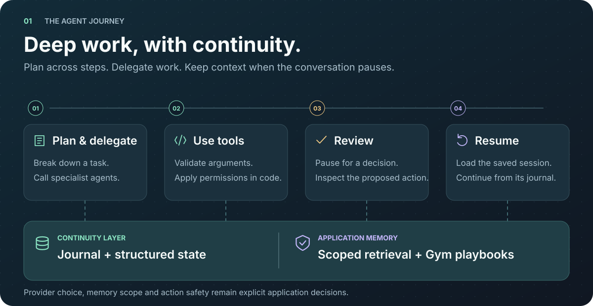

<p align="center">
  <picture>
    <source media="(prefers-color-scheme: dark)" srcset="assets/logo/qagents-logo-dark.svg">
    
  </picture>
</p>

<h3 align="center">Deep, long-running agents with memory and control.</h3>
<p align="center">Persistent context · Specialist teams · Human approvals · Resumable work</p>
<p align="center">
  <a href="#quickstart">Quickstart</a> · <a href="#providers">Providers</a> ·
  <a href="docs/index.md">Documentation</a> · <a href="examples/README.md">Examples</a> ·
  <a href="docs/integrations/gym.md">QAgent Gym</a>
</p>

---

**qagents** is a Python framework for deep, long-running agents: agents that work across
multiple steps, delegate to specialists, use memory and continue after a human decision.
Typed tools, explicit permissions and a durable session journal make their work inspectable.

### Why qagents?

Useful agent work often outlives a single model response. A research task needs several
sources; a proposal needs review; a support action may wait until tomorrow for approval.
Without persistent state, each interruption loses context. Without explicit action semantics,
retrying work can repeat a write that already happened.

qagents brings these concerns into the application: **plan and delegate**, **remember scoped
context**, **approve consequential actions**, and **resume recorded work**. Your code owns
the tools, identities, memory policy and destination behavior. QAgent Gym adds playbooks,
memory adapters and evaluation so you can test whether an agent improves across episodes.

**Status: 0.2.0, alpha.** Effects 0.3 and its crash harness are in development.
[Verification and limits](#what-is-verified).



## Quickstart

Python **3.11+**. From a checkout of this repository:

```bash
pip install -e .
```

The core needs **Pydantic and HTTPX**. Install your selected provider's SDK as described
[below](#providers). The example reads demo order data; replace the tool body with your
application's authorized data access.

```python
import asyncio
import os
from qagents import Agent, Limits, QCloudModel, tool


@tool(read_only=True)
def inspect_order(order_id: str) -> dict:
    """Read an order's delivery status and paid amount."""
    orders = {"A-1001": {"status": "delivered", "amount_minor": 4250, "currency": "EUR"}}
    return orders.get(order_id, {"error": "Order not found"})


async def main():
    model = QCloudModel(os.environ["QCLOUD_MODEL"])  # reads QCLOUD_API_KEY
    try:
        agent = Agent(
            model,
            instructions="Use the order tool. Report only what its result supports.",
            tools=[inspect_order],
            limits=Limits(max_turns=4, max_total_tokens=8000, timeout_s=60),
        )
        result = await agent.run("Check order A-1001. What is its status and paid amount?")
        print(result.status, result.text)
    finally:
        await model.aclose()


asyncio.run(main())
```

### From an answer to an approved action

The complete [support review assistant](examples/support_review.py) inspects an order,
proposes a support case, pauses for human approval, and writes the approved case to a real
local SQLite queue. The destination binds each operation id to one payload: a retry returns
the same case, and a changed request is refused.

```bash
python examples/support_review.py --provider qcloud
# The same application can use either adapter:
python examples/support_review.py --provider openai
python examples/support_review.py --provider anthropic
```

Set the selected provider's model and API key first. The example displays the exact proposed
arguments before asking for approval. It uses demo orders and a local review queue;
it does not issue refunds or send customer messages.


## Providers

<p align="center">
  <a href="https://www.qcloud.host/"></a>
  &nbsp;&nbsp;&nbsp;&nbsp;
  <a href="https://openai.com/"></a>
  &nbsp;&nbsp;&nbsp;&nbsp;
  <a href="https://www.anthropic.com/"></a>
</p>

Use the same agent, tools and session API with these adapters. Models have different capabilities,
limits and pricing; choose a tool-capable model available to your account.

| Provider | Adapter | Installation | Example environment |
|---|---|---|---|
| **QCloud** | `QCloudModel` via the official `qcloud_ai` SDK | SDK from source, below | `QCLOUD_MODEL`, `QCLOUD_API_KEY` |
| **OpenAI** | `OpenAIChatModel`, Chat Completions over HTTPX | Included in the core | `OPENAI_MODEL`, `OPENAI_API_KEY` |
| **Anthropic** | `AnthropicModel` via the official Messages API SDK | `pip install -e ".[anthropic]"` | `ANTHROPIC_MODEL`, `ANTHROPIC_API_KEY` |
| **Compatible endpoints** | `OpenAIChatModel` | Included in the core | Explicit model, API root and credentials |

**QCloud is a first-class provider.** Its adapter reads catalog capabilities and prices,
validates supported request settings and preserves typed SDK errors. Install its SDK:

```bash
pip install "git+https://github.com/qcloud-host/qcloud-python.git"
```

The SDK is not assumed to be available on PyPI. Select a catalog model that supports tools.
Switching providers does not require rewriting your tools:

```python
import os
from qagents import AnthropicModel, OpenAIChatModel, QCloudModel

qcloud = QCloudModel(os.environ["QCLOUD_MODEL"])
openai = OpenAIChatModel(
    os.environ["OPENAI_MODEL"],
    base_url="https://api.openai.com/v1",
    api_key=os.environ["OPENAI_API_KEY"],
    provider="openai",
    max_tokens_param="max_completion_tokens",
)
anthropic = AnthropicModel(os.environ["ANTHROPIC_MODEL"])
# Pass one selected model to Agent(...), then await its aclose() when done.
```

For vLLM, SGLang, llama.cpp, Ollama or a gateway, supply its OpenAI-compatible API root.
Compatibility depends on that endpoint's supported fields and model. Optional
`FallbackModel` and `RateLimitedModel` wrappers make failover and rate policies explicit.


See [provider configuration](docs/providers.md) for streaming, reasoning, retries and usage.

### A broader provider ecosystem

The providers below are **additional integration candidates**, beyond the three native
adapters above. Their logos identify the ecosystem we want applications to connect with;
dedicated adapters for these providers are not shipped in this release. Where a provider
offers a documented OpenAI-compatible endpoint, applications can configure `OpenAIChatModel`
and validate tools, streaming, usage and errors for their selected model.

<table>
  <tr>
    <td align="center"><a href="https://ai.google.dev/"><br>Google Gemini</a></td>
    <td align="center"><a href="https://mistral.ai/"><br>Mistral AI</a></td>
    <td align="center"><a href="https://www.deepseek.com/"><br>DeepSeek</a></td>
    <td align="center"><a href="https://groq.com/"><br>Groq</a></td>
    <td align="center"><a href="https://ollama.com/"><br>Ollama</a></td>
  </tr>
  <tr>
    <td align="center"><a href="https://x.ai/"><br>xAI</a></td>
    <td align="center"><a href="https://cohere.com/"><br>Cohere</a></td>
    <td align="center"><a href="https://aws.amazon.com/bedrock/"><br>Amazon Bedrock</a></td>
    <td align="center"><a href="https://azure.microsoft.com/"><br>Azure AI</a></td>
    <td align="center"><a href="docs/providers.md#openai-compatible-servers">Your endpoint<br>OpenAI-compatible HTTP</a></td>
  </tr>
</table>

Provider marks remain the property of their owners and do not imply endorsement.
[Asset sources](assets/providers/README.md).

## What you can build

| Capability | API | Guide |
|---|---|---|
| Validated tools and arguments | `@tool`, `RunContext[Deps]` | [Tools](docs/concepts/tools.md) |
| Typed answers | `Agent(..., output_type=YourModel)` | [Structured output](docs/concepts/structured-output.md) |
| Human approvals | `requires_approval=True`, `Approval.for_call` | [Permissions](docs/concepts/permissions.md) |
| Persistent conversations | `Session`, `SQLiteStore`, `PostgresStore` | [Sessions](docs/concepts/sessions.md) |
| Scoped application memory | `RunContext.state`, application-selected session identity | [Memory example](examples/scoped_memory.py) |
| Background recovery | `AgentRuntime`, leases, `recover()` | [Serving](docs/serving.md) |
| Specialist teams | Sub-agents, team messaging, handoffs, `fan_out`, `route` | [Multi-agent patterns](docs/concepts/multi-agent.md) |
| Resumable workflows | `Workflow.step`, `Workflow.run_agent` | [Workflow API](docs/reference/workflow.md) |
| Streaming applications | `agent.stream()`, typed events, AG-UI | [Streaming](docs/concepts/streaming.md) |
| External coding agents | ACP, Devvi, MCP tool serving | [External agents](docs/concepts/external-agents.md) |
| Traces and evaluations | OpenTelemetry, MLflow, scripted models | [Testing](docs/testing.md) |

### Tools

A tool is a Python function with a docstring and type hints. Its signature becomes the tool
schema. A `RunContext` parameter supplies application dependencies and a stable operation id;
these are not arguments chosen by the model. [Built-in toolkits](docs/toolkits.md) cover files,
shell commands, web access, notes, planning, clocks, human input and MCP servers.

### Permissions and approvals

Permissions run in code: deny rules, your policy callback, ask rules, allow rules, then the
mode default. A denied tool does not run. An unanswered approval pauses the session.

For approvals exchanged outside the process, configure an `approval_secret` and preserve the
pending token with `Approval.for_call`. The support example uses a local terminal.
Effects tools that ask for approval need the secret too: without it, an effect whose outcome is
unknown is never re-sent automatically and, unless a lookup finds it, waits for an operator
(the agent warns when it is built).
See the [approval guide](docs/concepts/permissions.md) before exposing a remote approval endpoint.

### Sessions and recovery

The JSON journal records messages, tool starts, results and decisions. A recorded result is
replayed on recovery. Interrupted tools run again only when their declared semantics permit it.
An unfinished ordinary `Workflow.step` function may run again.

Pass `ctx.operation_id` to a destination that enforces idempotency. Set `idempotent=True` only
when the destination makes retries safe. A checkpoint alone cannot prove whether an external
write happened. See [recovery behavior](docs/concepts/sessions.md) and [design boundaries](docs/design.md).

### Memory across long-running work

Memory has three roles. The **journal** records execution history. **Structured session state**
holds application facts and preferences. **Retrieved context** brings relevant memories and
playbook entries into later runs through application or QAgent Gym adapters.


Run a complete offline memory example:

```bash
python -m examples.scoped_memory --database .work/preferences.db
```

It approves a preference write, closes and reopens SQLite, and reads the preference with
a new agent. The same tenant/user sees `el`; a different tenant or user sees `unset`.
The application supplies identity; the model cannot choose another user's memory scope.
See [scoped memory](docs/integrations/gym.md#start-with-session-memory) for the code and tests.

### QAgent Gym: learn across episodes

[QAgent Gym](docs/integrations/gym.md) adds ACE-style context learning, playbooks, scoped
memory and evaluations in a separate project. Mem0 retrieval, LangGraph and DSPy adapters,
ElevenLabs synthesis and Twilio telephony recipes connect to the application boundary.
Context updates and RL weight training are different workflows; the integration guide states
what each example actually exercises.

## Testing your agents

Keep your application tools and stores; replace the model with a deterministic script:

```python
from pathlib import Path
from examples.support_review import DEMO_ORDERS, ReviewQueue, SupportDeps, build_agent
from qagents import Session, SQLiteStore
from qagents.models.testing import ScriptedModel, call

model = ScriptedModel([
    call("inspect_order", order_id="A-1001"),
    "Order A-1001 was delivered. The recorded payment is EUR 42.50.",
])
agent = build_agent(model)
deps = SupportDeps(DEMO_ORDERS, ReviewQueue(Path(".work/reviews.db")))

async with SQLiteStore(".work/sessions.db") as store:
    result = await agent.run("Check order A-1001", session=Session(store, id="test"), deps=deps)
    assert result.status == "completed"
```

This uses top-level `await`, suitable for a notebook or async test.
The [support example tests](tests/examples/test_support_review.py) also cover pause/reopen/resume,
declined actions, concurrent retries and changed-payload refusal.

### Effects 0.3 — in development

Effects adds an intent/receipt protocol for external actions, evidence-based retry decisions and
a crash harness that checks the destination as well as the journal. Integration is ongoing.
Draft diagrams and passing foundation tests do not represent a released guarantee.
The release gate includes the integrated runtime, crash controls and recovery benchmark.

## What is verified

| Area | Evidence in this repository |
|---|---|
| Providers | OpenAI HTTP transport tests; Anthropic/QCloud tests through their actual SDKs with local transports |
| Agent behavior | Scripted tools, approvals, state, limits, streaming and cancellation |
| Persistence | Memory/SQLite tests; PostgreSQL/recovery tests with a configured test database |
| Support example | Local SQLite queue, approved/declined paths, store reopen, concurrent duplicate requests |
| Integrations | MCP client/server, ACP/Devvi fixtures, AG-UI, OpenTelemetry and MLflow tests |
| Documentation | Python snippet compilation, API checks and example tests |

These checks do not establish live model quality, arbitrary endpoint compatibility or production
performance. Live QCloud acceptance, final Effects 0.3 acceptance and workload-specific
load/security checks remain separate gates. The [live acceptance example](examples/live_acceptance.py)
requires an explicitly configured account and makes billable requests.

## Documentation

[Getting started](docs/getting-started.md) · [Concepts](docs/index.md) ·
[API reference](docs/reference/agent.md) · [Examples](examples/README.md) ·
[Changelog](CHANGELOG.md) · [Coding agents](docs/coding-agents.md) · [AGENTS.md](AGENTS.md)

```bash
pip install -e ".[docs]"
mkdocs serve
```

The documentation MCP server exposes installed-version signatures and examples.
Its command line also works directly:

```bash
python -m qagents.docs_mcp search "pause a tool for approval"
python -m qagents.docs_mcp api Agent.resume
python -m qagents.docs_mcp check examples/support_review.py
```

README illustrations are generated by a small, versioned Python SVG renderer.
Detailed Mermaid sources are kept alongside them. [Rebuild the diagrams](docs/diagrams/README.md).
