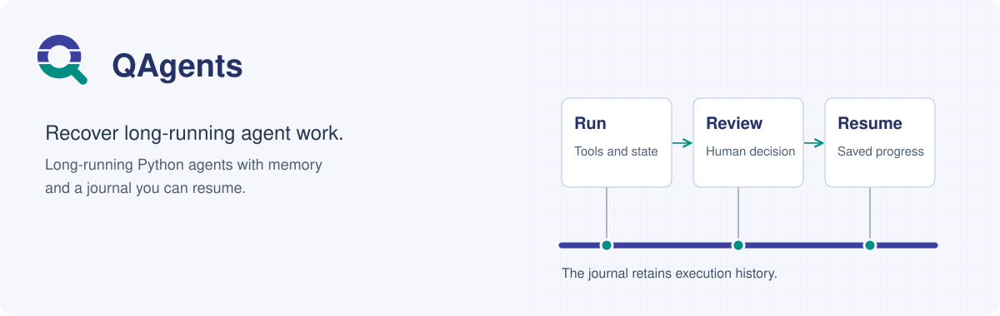
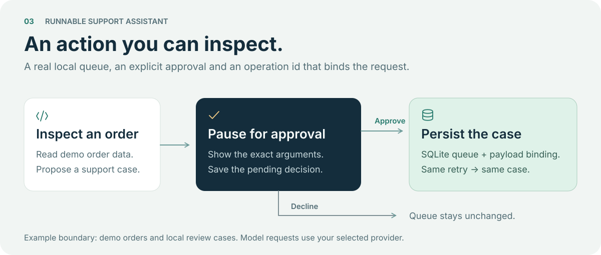
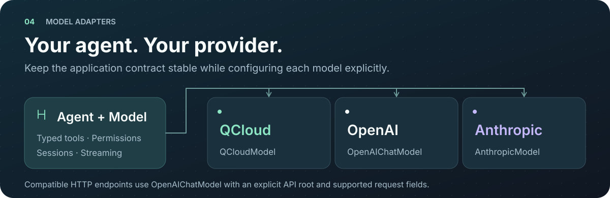
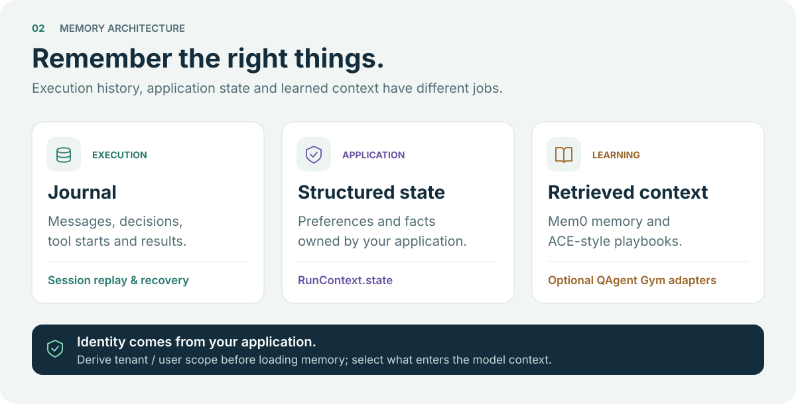

# QAgents

A Python library for deep, long-running agents with memory and recoverable execution.



Build agents in Python with typed tools, specialist sub-agents and scoped memory.
QAgents records messages, tool results and decisions in a session journal, so an
agent can wait for human approval and resume its work after a worker restarts.
The library includes a local documentation server and API checker to help
Codex, Claude Code and other coding assistants build against the installed version.

[Get started](#quickstart) | [Build with a coding assistant](#build-with-a-coding-assistant) |
[Providers](#providers) | [Documentation](docs/index.md) |
[Application examples](https://github.com/qagents-ai/qagents-examples) |
[QAgent Gym](https://github.com/qagents-ai/qagent-gym)

## Motivation

A proposal may need several rounds of review. A support action may wait until
tomorrow for approval. During that time, workers stop, credentials expire and
external services sometimes accept a request without returning a response.
Application code needs to know which work finished and which outcome is still
uncertain before it retries.

QAgents records the execution history and exposes permissions, limits and recovery
decisions in Python. You own the tools, application identities and destination
behavior. Session state retains facts within a run or conversation. Retrieval
tools connect information across sessions, while the separate QAgent Gym package
can turn feedback into playbooks for later tasks.

**Status: 0.2.0, alpha.** Work on `main` includes unreleased capabilities,
including persistent team messaging and the [Effects preview](docs/effects-preview.md).
The source is available on GitHub. The package is not on PyPI and no open-source
license is granted. See the [changelog](CHANGELOG.md) and
[verification limits](#what-is-verified).

## Quickstart

Requires Python 3.11 or newer. From a checkout of this repository:

```bash
pip install -e .
```

The core depends on Pydantic and HTTPX. Install your selected provider's SDK as described
[below](#providers). The example reads demo order data. Replace the tool body with your
application's authorized data access.

```python
import asyncio
import os
from qagents import Agent, Limits, QCloudModel, tool


@tool(read_only=True)
def inspect_order(order_id: str) -> dict:
    """Read an order's delivery status and paid amount."""
    orders = {"A-1001": {"status": "delivered", "amount_minor": 4250, "currency": "EUR"}}
    return orders.get(order_id, {"error": "Order not found"})


async def main():
    model = QCloudModel(os.environ["QCLOUD_MODEL"])  # reads QCLOUD_API_KEY
    try:
        agent = Agent(
            model,
            instructions="Use the order tool. Report only what its result supports.",
            tools=[inspect_order],
            limits=Limits(max_turns=4, max_total_tokens=8000, timeout_s=60),
        )
        result = await agent.run("Check order A-1001. What is its status and paid amount?")
        print(result.status, result.text)
    finally:
        await model.aclose()


asyncio.run(main())
```

To try the execution flow without provider credentials, run
`python examples/offline_tour.py`. It uses a scripted model to exercise tool calls,
a human approval pause and a handoff.

### Add an action that needs approval

The complete [support review assistant](examples/support_review.py) inspects an order,
proposes a support case, pauses for human approval, and writes the approved case to a real
local SQLite queue. The destination binds each operation id to one payload: a retry returns
the same case, and a changed request is refused.

```bash
python examples/support_review.py --provider qcloud
# The same application can use either adapter:
python examples/support_review.py --provider openai
python examples/support_review.py --provider anthropic
```

Set the selected provider's model and API key first. The example displays the exact proposed
arguments before asking for approval. It uses demo orders and writes approved cases to a local review queue. Refunds
and customer messages are outside this example.



## Build with a coding assistant

Use a coding assistant to write your application, with QAgents providing the
runtime. The included docs MCP server lets the assistant search guides, inspect
real Python signatures and check its code for unsupported API calls. It runs
locally and needs no provider key.

From the QAgents checkout, install the MCP extra:

```bash
python -m pip install -e ".[mcp]"
```

Register the server in the coding assistant you use. Run the chosen command with
the environment containing QAgents active, or replace `python` with its full path:

```bash
# Codex CLI
codex mcp add qagents-docs -- python -m qagents.docs_mcp

# Claude Code
claude mcp add qagents-docs -- python -m qagents.docs_mcp
```

For example, ask your assistant:

```text
Build a QAgents support assistant with a read-only order lookup and a tool that
queues a case after human approval. Use SQLite sessions and finite run limits.
Read the installed API through qagents-docs before writing code. Add offline
tests for approval, refusal and resuming after the session store is reopened.
Run the QAgents code checker on each Python file you create.
```

The [support review application](examples/support_review.py) is a working starting
point for that task. In your own application repository, give the assistant the
[QAgents development rules](docs/coding-agents.md#agentsmd). The
[setup guide](docs/coding-agents.md) also covers Cursor, VS Code, the Claude Code
skill and the documentation CLI.

## Providers

<p align="center">
  <a href="https://www.qcloud.host/"></a>
  &nbsp;&nbsp;&nbsp;&nbsp;
  <a href="https://openai.com/"></a>
  &nbsp;&nbsp;&nbsp;&nbsp;
  <a href="https://www.anthropic.com/"></a>
</p>

Use the same agent, tools and session API with these adapters. Models have different capabilities,
limits and pricing. Choose a tool-capable model available to your account.

| Provider | Adapter | Installation | Example environment |
|---|---|---|---|
| **QCloud** | `QCloudModel` via the official `qcloud_ai` SDK | SDK from source, below | `QCLOUD_MODEL`, `QCLOUD_API_KEY` |
| **OpenAI** | `OpenAIChatModel`, Chat Completions over HTTPX | Included in the core | `OPENAI_MODEL`, `OPENAI_API_KEY` |
| **Anthropic** | `AnthropicModel` via the official Messages API SDK | `pip install -e ".[anthropic]"` | `ANTHROPIC_MODEL`, `ANTHROPIC_API_KEY` |
| **Compatible endpoints** | `OpenAIChatModel` | Included in the core | Explicit model, API root and credentials |

The QCloud adapter reads catalog capabilities and prices,
validates supported request settings and preserves typed SDK errors. Install its SDK:

```bash
pip install "git+https://github.com/qcloud-host/qcloud-python.git"
```

The SDK is not on PyPI. Install it from source before you use the `qcloud` extra. Otherwise
pip looks up the extra's `qcloud-ai` requirement on PyPI. Select a catalog model that supports
tools.
Switching providers does not require rewriting your tools:

```python
import os
from qagents import AnthropicModel, OpenAIChatModel, QCloudModel

qcloud = QCloudModel(os.environ["QCLOUD_MODEL"])
openai = OpenAIChatModel(
    os.environ["OPENAI_MODEL"],
    base_url="https://api.openai.com/v1",
    api_key=os.environ["OPENAI_API_KEY"],
    provider="openai",
    max_tokens_param="max_completion_tokens",
)
anthropic = AnthropicModel(os.environ["ANTHROPIC_MODEL"])
# Pass one selected model to Agent(...), then await its aclose() when done.
```

For vLLM, SGLang, llama.cpp, Ollama or a gateway, supply its OpenAI-compatible API root.
Compatibility depends on that endpoint's supported fields and model. Optional
`FallbackModel` and `RateLimitedModel` wrappers make failover and rate policies explicit.

Model strings such as `"qcloud:<model-id>"` resolve through `register_provider`. Only the
`qcloud:` and `anthropic:` prefixes are registered by default, so the command line reaches
other providers only through code. There is no OpenAI Responses API adapter.



See [provider configuration](docs/providers.md) for streaming, reasoning, retries and usage.

<details>
<summary>Other providers and compatible endpoints</summary>

The following providers are integration candidates. QAgents does not ship dedicated
adapters for them. Where a provider
offers a documented OpenAI-compatible endpoint, applications can configure `OpenAIChatModel`
and validate tools, streaming, usage and errors for their selected model.

<table>
  <tr>
    <td align="center"><a href="https://ai.google.dev/"><br>Google Gemini</a></td>
    <td align="center"><a href="https://mistral.ai/"><br>Mistral AI</a></td>
    <td align="center"><a href="https://www.deepseek.com/"><br>DeepSeek</a></td>
    <td align="center"><a href="https://groq.com/"><br>Groq</a></td>
    <td align="center"><a href="https://ollama.com/"><br>Ollama</a></td>
  </tr>
  <tr>
    <td align="center"><a href="https://x.ai/"><br>xAI</a></td>
    <td align="center"><a href="https://cohere.com/"><br>Cohere</a></td>
    <td align="center"><a href="https://aws.amazon.com/bedrock/"><br>Amazon Bedrock</a></td>
    <td align="center"><a href="https://azure.microsoft.com/"><br>Azure AI</a></td>
    <td align="center"><a href="docs/providers.md#openai-compatible-servers">Your endpoint<br>OpenAI-compatible HTTP</a></td>
  </tr>
</table>

Provider marks remain the property of their owners and do not imply endorsement.
[Asset sources](assets/providers/README.md).


</details>

## Features

| Application need | QAgents support | Guide |
| --- | --- | --- |
| Inspectable tool use | Typed Python tools, validated arguments and explicit permissions | [Tools](docs/concepts/tools.md) |
| Human review | Pause a proposed action and resume the recorded call after a decision | [Approvals](docs/concepts/permissions.md) |
| Work that survives a restart | Session journals, store leases and runtime recovery | [Sessions](docs/concepts/sessions.md), [workers](docs/serving.md) |
| Specialist teams | Child agents, handoffs and a persistent SQLite mailbox | [Multi-agent work](docs/concepts/multi-agent.md) |
| Memory over longer tasks | Structured session state, compaction and application-owned retrieval | [Memory integration](docs/integrations/gym.md) |
| Multi-step jobs | Journaled workflow steps, signals and timers | [Workflows](docs/concepts/multi-agent.md#workflows) |
| Uncertain external writes | Declared effects and operator settlement, currently a preview | [Effects](docs/effects-preview.md) |
| Reproducible checks | Scripted models, cassettes and application evaluators | [Testing](docs/testing.md) |

The [capability reference](docs/capabilities.md) lists the APIs and marks unreleased
or experimental features. Provider behavior and external writes still depend on
the contracts your application configures.

## Memory and QAgent Gym



The execution journal preserves what happened. Session state stores application
facts and preferences. A retrieval service such as Mem0 can bring relevant
information into another session, using identities and retention rules supplied
by your application.

[QAgent Gym](docs/integrations/gym.md) adds practice tasks, feedback and evaluation
around an agent. It stores lessons in a playbook and retrieves them for later
episodes. This changes the agent's context while keeping model weights fixed.
Model training uses a separate training job.

Run the local memory example to approve a preference, reopen its store and recall
it with another agent:

```bash
python -m examples.scoped_memory --database preferences.db
```

## Testing your agents

Repeated evaluations can measure both pass@k and pass^k, with paired confidence
intervals across cases. `TrialTarget` gives each repetition a stable index for
seeds and fresh fixtures. Run `python -m examples.reliability` or read the
[reliability guide](docs/guides/reliability.md).

Keep your application tools and stores and replace the model with a deterministic script:

```python
from pathlib import Path
from examples.support_review import DEMO_ORDERS, ReviewQueue, SupportDeps, build_agent
from qagents import Session, SQLiteStore
from qagents.models.testing import ScriptedModel, call

model = ScriptedModel([
    call("inspect_order", order_id="A-1001"),
    "Order A-1001 was delivered. The recorded payment is EUR 42.50.",
])
agent = build_agent(model)
deps = SupportDeps(DEMO_ORDERS, ReviewQueue(Path(".work/reviews.db")))

async with SQLiteStore(".work/sessions.db") as store:
    result = await agent.run("Check order A-1001", session=Session(store, id="test"), deps=deps)
    assert result.status == "completed"
```

This uses top-level `await`, suitable for a notebook or async test.
The [support example tests](tests/examples/test_support_review.py) also cover pause/reopen/resume,
declined actions, concurrent retries and changed-payload refusal.


## Effects 0.3 preview

An external system can apply a request even when the response never reaches the
worker. Effects records an intent before sending and uses recorded evidence,
destination contracts or a lookup to decide how recovery should continue. An
unresolved outcome can be held for operator review.

Effects is unreleased and supports memory and SQLite stores. The default crash
fault set still reports violations on correct fixtures, so it is not a release
gate. Read the [preview status and open issues](docs/effects-preview.md) before
using it, or follow the [external-action recovery guide](docs/guides/recover-effect.md).

## How QAgents compares

QAgents concentrates on recoverable Python agent work with explicit tool
permissions and application-owned state. Frameworks such as LangGraph and CrewAI
have larger integration ecosystems and managed deployment options. The
[comparison guide](docs/comparison.md) covers the differences, its dated source
snapshot and the limits of the matched recovery benchmark.

## What is verified

The local suite exercises tool calls, approvals, streaming, state and recovery.
It also checks persistent messages across processes, destination deduplication,
Effects decisions and worker termination at selected durable boundaries.
Provider adapter tests use local transports, including the actual Anthropic and
QCloud SDKs when installed.

These checks establish behavior under their fixtures. They do not establish live
model quality, arbitrary endpoint compatibility or production performance.
Live QCloud acceptance, the Stripe sandbox probe and final Effects acceptance
remain open. See [design and verification evidence](docs/design.md#what-is-verified)
and [Effects evidence](docs/effects-preview.md).

## Documentation

Start with [installation](docs/getting-started.md), then follow the
[support review walkthrough](docs/guides/support-review.md). The
[application collection](https://github.com/qagents-ai/qagents-examples) includes
research, KA220 proposals and persistent team examples with checked local outputs.

```bash
pip install -e ".[docs]"
mkdocs serve
```

Coding agents can query the installed API and check their snippets:

```bash
python -m qagents.docs_mcp search "pause a tool for approval"
python -m qagents.docs_mcp api Agent.resume
python -m qagents.docs_mcp check examples/support_review.py
```

See the [API reference](docs/reference/agent.md), [coding-agent setup](docs/coding-agents.md)
and [contributor instructions](AGENTS.md). The [diagram sources](docs/diagrams/README.md)
and [brand renderer](assets/brand/README.md) are versioned with the documentation.
