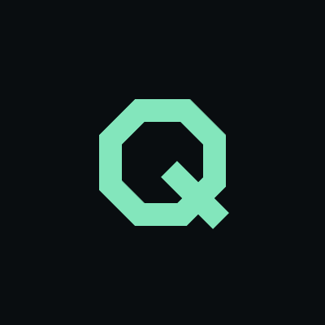

<p align="center">
  <picture>
    <source media="(prefers-color-scheme: dark)" srcset="assets/logo/qagents-logo-dark.svg">
    
  </picture>
</p>

<h3 align="center">Deep, long-running agents with memory and control.</h3>
<p align="center">Persistent context · Specialist teams · Human approvals · Resumable work</p>
<p align="center">
  <a href="#quickstart">Quickstart</a> · <a href="#providers">Providers</a> ·
  <a href="#features">Features</a> · <a href="#how-qagents-compares">Comparison</a> ·
  <a href="docs/index.md">Documentation</a> · <a href="examples/README.md">Examples</a> ·
  <a href="docs/integrations/gym.md">QAgent Gym</a>
</p>

---

**qagents** is a Python framework for deep, long-running agents: agents that work across
multiple steps, delegate to specialists, use memory and continue after a human decision.
Typed tools, explicit permissions and a durable session journal make their work inspectable.

### Why qagents?

Useful agent work often outlives a single model response. A research task needs several
sources; a proposal needs review; a support action may wait until tomorrow for approval.
Without persistent state, each interruption loses context. Without explicit action semantics,
retrying work can repeat a write that already happened.

qagents brings these concerns into the application: **plan and delegate**, **remember scoped
context**, **approve consequential actions**, and **resume recorded work**. Your code owns
the tools, identities, memory policy and destination behavior. QAgent Gym, a separate project
in a private repository, adds playbooks, memory adapters and evaluation so you can test whether
an agent improves across episodes.

**Status: 0.2.0, alpha.** The [changelog](CHANGELOG.md) describes the 0.2.0 release.
Work on `main` since then is not released yet: external agents, the MCP tool server, team
messaging, and [Effects 0.3](#effects-03-preview) with its crash harness. The
[features](#features) below mark each such item. There is no LICENSE file yet, so no
open-source license is granted. The GitHub repository is private, and the package is not on
PyPI.
[Verification and limits](#what-is-verified).


## Quickstart

Python **3.11+**. From a checkout of this repository:

```bash
pip install -e .
```

The core needs **Pydantic and HTTPX**. Install your selected provider's SDK as described
[below](#providers). The example reads demo order data; replace the tool body with your
application's authorized data access.

```python
import asyncio
import os
from qagents import Agent, Limits, QCloudModel, tool


@tool(read_only=True)
def inspect_order(order_id: str) -> dict:
    """Read an order's delivery status and paid amount."""
    orders = {"A-1001": {"status": "delivered", "amount_minor": 4250, "currency": "EUR"}}
    return orders.get(order_id, {"error": "Order not found"})


async def main():
    model = QCloudModel(os.environ["QCLOUD_MODEL"])  # reads QCLOUD_API_KEY
    try:
        agent = Agent(
            model,
            instructions="Use the order tool. Report only what its result supports.",
            tools=[inspect_order],
            limits=Limits(max_turns=4, max_total_tokens=8000, timeout_s=60),
        )
        result = await agent.run("Check order A-1001. What is its status and paid amount?")
        print(result.status, result.text)
    finally:
        await model.aclose()


asyncio.run(main())
```

No key yet? `python examples/offline_tour.py` runs the loop, an approval pause, a resume and
a handoff with a scripted model, offline.

### From an answer to an approved action *(unreleased)*

The complete [support review assistant](examples/support_review.py) inspects an order,
proposes a support case, pauses for human approval, and writes the approved case to a real
local SQLite queue. The destination binds each operation id to one payload: a retry returns
the same case, and a changed request is refused.

```bash
python examples/support_review.py --provider qcloud
# The same application can use either adapter:
python examples/support_review.py --provider openai
python examples/support_review.py --provider anthropic
```

Set the selected provider's model and API key first. The example displays the exact proposed
arguments before asking for approval. It uses demo orders and a local review queue;
it does not issue refunds or send customer messages.


## Providers

<p align="center">
  <a href="https://www.qcloud.host/"></a>
  &nbsp;&nbsp;&nbsp;&nbsp;
  <a href="https://openai.com/"></a>
  &nbsp;&nbsp;&nbsp;&nbsp;
  <a href="https://www.anthropic.com/"></a>
</p>

Use the same agent, tools and session API with these adapters. Models have different capabilities,
limits and pricing; choose a tool-capable model available to your account.

| Provider | Adapter | Installation | Example environment |
|---|---|---|---|
| **QCloud** | `QCloudModel` via the official `qcloud_ai` SDK | SDK from source, below | `QCLOUD_MODEL`, `QCLOUD_API_KEY` |
| **OpenAI** | `OpenAIChatModel`, Chat Completions over HTTPX | Included in the core | `OPENAI_MODEL`, `OPENAI_API_KEY` |
| **Anthropic** | `AnthropicModel` via the official Messages API SDK | `pip install -e ".[anthropic]"` | `ANTHROPIC_MODEL`, `ANTHROPIC_API_KEY` |
| **Compatible endpoints** | `OpenAIChatModel` | Included in the core | Explicit model, API root and credentials |

**QCloud is a first-class provider.** Its adapter reads catalog capabilities and prices,
validates supported request settings and preserves typed SDK errors. Install its SDK:

```bash
pip install "git+https://github.com/qcloud-host/qcloud-python.git"
```

The SDK is not on PyPI. Install it from source before you use the `qcloud` extra; otherwise
pip looks up the extra's `qcloud-ai` requirement on PyPI. Select a catalog model that supports
tools.
Switching providers does not require rewriting your tools:

```python
import os
from qagents import AnthropicModel, OpenAIChatModel, QCloudModel

qcloud = QCloudModel(os.environ["QCLOUD_MODEL"])
openai = OpenAIChatModel(
    os.environ["OPENAI_MODEL"],
    base_url="https://api.openai.com/v1",
    api_key=os.environ["OPENAI_API_KEY"],
    provider="openai",
    max_tokens_param="max_completion_tokens",
)
anthropic = AnthropicModel(os.environ["ANTHROPIC_MODEL"])
# Pass one selected model to Agent(...), then await its aclose() when done.
```

For vLLM, SGLang, llama.cpp, Ollama or a gateway, supply its OpenAI-compatible API root.
Compatibility depends on that endpoint's supported fields and model. Optional
`FallbackModel` and `RateLimitedModel` wrappers make failover and rate policies explicit.

Model strings such as `"qcloud:<model-id>"` resolve through `register_provider`. Only the
`qcloud:` and `anthropic:` prefixes are registered by default, so the command line reaches
other providers only through code. There is no OpenAI Responses API adapter.


See [provider configuration](docs/providers.md) for streaming, reasoning, retries and usage.

### A broader provider ecosystem

The providers below are **additional integration candidates**, beyond the three native
adapters above. Their logos identify the ecosystem we want applications to connect with;
dedicated adapters for these providers are not shipped in this release. Where a provider
offers a documented OpenAI-compatible endpoint, applications can configure `OpenAIChatModel`
and validate tools, streaming, usage and errors for their selected model.

<table>
  <tr>
    <td align="center"><a href="https://ai.google.dev/"><br>Google Gemini</a></td>
    <td align="center"><a href="https://mistral.ai/"><br>Mistral AI</a></td>
    <td align="center"><a href="https://www.deepseek.com/"><br>DeepSeek</a></td>
    <td align="center"><a href="https://groq.com/"><br>Groq</a></td>
    <td align="center"><a href="https://ollama.com/"><br>Ollama</a></td>
  </tr>
  <tr>
    <td align="center"><a href="https://x.ai/"><br>xAI</a></td>
    <td align="center"><a href="https://cohere.com/"><br>Cohere</a></td>
    <td align="center"><a href="https://aws.amazon.com/bedrock/"><br>Amazon Bedrock</a></td>
    <td align="center"><a href="https://azure.microsoft.com/"><br>Azure AI</a></td>
    <td align="center"><a href="docs/providers.md#openai-compatible-servers">Your endpoint<br>OpenAI-compatible HTTP</a></td>
  </tr>
</table>

Provider marks remain the property of their owners and do not imply endorsement.
[Asset sources](assets/providers/README.md).

## Features

Unmarked features are in the 0.2.0 release. *(unreleased)* marks work on `main` that is not
in a release yet. *(Effects 0.3 preview)* marks the unreleased [Effects](#effects-03-preview)
work. *(experimental)* marks an API that is likely to change.

### Agent loop and limits

| Feature | API | Docs |
|---|---|---|
| Model requests and tool calls alternate until a final answer. Each model response is journaled before any tool it requested starts. | `Agent`, `run`, `stream`, `run_sync`, `resume`, `copy`, `RunResult` | [The loop](docs/concepts/loop.md) |
| A run ends `completed`, `paused`, `limit_reached`, `cancelled` or `blocked`. | `RunResult.status` | [What a run returns](docs/concepts/loop.md#what-a-run-returns) |
| Hard limits: turns (30 by default), tokens, cost and tool calls, counted across resumes; wall-clock time per `run` or `resume` call; and nesting depth (5 by default). A cost limit fails closed on an unpriced response. | `Limits(max_turns, max_total_tokens, max_cost_usd, timeout_s, max_tool_calls, max_depth)` | [Limits](docs/concepts/loop.md#limits) |
| Per-tool timeouts, a parallel-tool policy, a result size cap and retries. By default the retry loop does not re-send a model request that may have been billed (`retry_ambiguous=False`). The in-flight request of a worker that died is sent again on recovery. | `Limits(tool_timeout_s, parallel_tools, max_tool_result_chars, model_retries, retry_ambiguous)` | [Retries and billing](docs/concepts/loop.md#retries-and-billing) |
| A cancel or timeout reaches the provider request, compaction and running tools. The model is told per call whether it never started, was cancelled or has an unknown outcome. | `RunStream.cancel(reason)`, `RunHandle.cancel`, `Limits.timeout_s` | [Cancel](docs/concepts/streaming.md#cancel) |

### Tools

A tool is a Python function with a docstring and type hints. Its signature becomes the tool
schema. A `RunContext` parameter supplies application dependencies and a stable operation id;
these are not arguments chosen by the model. [Built-in toolkits](docs/toolkits.md) cover files,
shell commands, web access, notes, planning, clocks, human input and MCP servers.

#### Tool API

| Feature | API | Docs |
|---|---|---|
| Typed tools. Pydantic validates the arguments before permissions, hooks or the function run. Sync tools run on a qagents-owned thread pool. | `@tool`, `Tool`, `Toolkit`, `ToolError`, `ToolTimeout` | [Tools](docs/concepts/tools.md) |
| Tool flags | `read_only`, `idempotent`, `requires_approval`, `timeout`, `strict`, `deferred` | [Flags](docs/concepts/tools.md#flags) |
| A context the model does not see: typed dependencies, an `operation_id` that stays the same when a call is repeated after a resume, session state, custom events and extra usage. | `RunContext[Deps]`, `deps`, `operation_id`, `state`, `emit`, `add_usage` | [The run context](docs/concepts/tools.md#the-run-context) |
| Deferred tools pause the run; the result arrives later, from any process that can open the session. | `@tool(deferred=True)`, `DeferToolCall`, `PendingInput`, `agent.resume(results=...)` | [Deferred job example](examples/patterns/deferred_job.py) |
| A tool call journals a fact before it acts and reads it on a later attempt. Code outside the model can make a validated, permission-checked, journaled tool call of the run. *(unreleased)* | `RunContext.checkpoint`, `checkpoints`, `call_tool` | [The journal and crash recovery](docs/concepts/external-agents.md#the-journal-and-crash-recovery) |
| A per-call memo revived on a rerun, and declared effects performed from a tool body. *(Effects 0.3 preview)* | `RunContext.memo`, `RunContext.perform`, `@tool(effects=[...])` | [Effects](#effects-03-preview) |

### Permissions and approvals

| Feature | API | Docs |
|---|---|---|
| Rules in code, in a fixed order: deny, `can_use_tool`, ask, allow, mode, then the tool's `requires_approval` flag. A check that raises refuses the call. | `Permissions(allow, ask, deny, mode, can_use_tool, on_ask)`, `Decision` | [The decision order](docs/concepts/permissions.md#the-decision-order) |
| An unanswered approval pauses the run. Resume in any process: deny rules and edited arguments are checked again, and a call that has a result never runs again. | `requires_approval=True`, `PendingApproval`, `agent.resume(approvals=...)`, `Approval(arguments=...)` | [Pause and resume](docs/concepts/permissions.md#pause-and-resume) |
| Signed pauses: an HMAC-SHA256 token bound to the session, the call's position and the pause kind. A missing or wrong token raises before anything runs. | `Permissions(approval_secret=...)`, `Approval.for_call`, `InputResult.for_call`, `ApprovalTokenError` | [Signed pauses](docs/concepts/permissions.md#signed-pauses) |
| Integers outside the safe JSON range are refused before signing. *(unreleased)* | `Permissions(approval_secret=...)` | [Signed pauses](docs/concepts/permissions.md#signed-pauses) |
| Versioned decision records for effect tools, a conflicting second answer refused, and recorded hook changes to approved arguments. *(Effects 0.3 preview)* | `ApprovalConflictError`, `Hooks.may_change_approved_arguments` | [Effects](#effects-03-preview) |

With the default `Permissions`, a tool runs without asking unless it sets
`requires_approval=True` or matches an `ask` rule, even if it writes. For approvals exchanged
outside the process, configure an `approval_secret` and preserve the pending token with
`Approval.for_call`.
Effects tools that ask for approval need the secret too when an effect declares a `Dedupe` or
`Unique` contract or an authoritative lookup: without it, such an effect whose outcome is unknown
is never re-sent automatically and, unless a lookup finds it, waits for an operator (the agent
warns when it is built, or at run start for a toolkit's tools).
Opaque and reconcilable effects are never re-sent automatically, with or without the secret.
Read the [approval guide](docs/concepts/permissions.md) before exposing a remote approval
endpoint.

### Sessions and recovery

| Feature | API | Docs |
|---|---|---|
| An append-only, plain-JSON journal of messages, tool starts and results, decisions and run boundaries. Run state is derived from it. Nothing is pickled. | `Session`, `SessionStore`, `Entry` | [The journal](docs/concepts/sessions.md#the-journal) |
| One JSON dict of session state for tools, hooks and instructions, restored on every run and resume. | `RunContext.state`, `state=` | [Scoped memory example](examples/scoped_memory.py) |
| Built-in stores with session status, listing and fenced leases. SQLite uses WAL and `synchronous=FULL`. | `InMemoryStore`, `SQLiteStore(path)` | [Stores](docs/concepts/sessions.md#stores) |
| The same journal in PostgreSQL, with database-clock leases for workers on several hosts. Runs with declared effects are refused on it. | `qagents.stores.PostgresStore`, extra `postgres` | [Stores](docs/concepts/sessions.md#stores) |
| Background runs under store leases with heartbeats. `recover()` takes over dead or failed runs; it skips a run whose last failure was ambiguous unless that run allows `retry_ambiguous`. | `AgentRuntime`, `start`, `submit`, `resume`, `recover`, `RunHandle` | [Serving](docs/serving.md) |
| Lease and journal hardening: final state committed with tool outcomes, a run interrupted when lease renewal is refused, a fresh owner token for each acquisition. *(unreleased)* | `Agent.run`, `AgentRuntime` | [Sessions and recovery](docs/concepts/sessions.md) |
| A lease lost while `start` or `resume` prepares a run raises `LeaseError` instead of a stray `CancelledError`. One lost while `recover()` prepares a run makes it pass that session over with a logged warning, so `run_forever` keeps polling. A cancel from outside still propagates. *(unreleased)* | `AgentRuntime.start`, `resume`, `recover`, `LeaseError` | [Serving](docs/serving.md) |
| Store features for effects: stable entry ids, lease epochs, a store clock, an effect registry and cross-session claims, written through one fenced writer per session. *(Effects 0.3 preview)* | `SessionStore.features`, `acquire_lease_grant`, `LeasedWriter`, `Session.effects` | [Effects](#effects-03-preview) |
| Operator entry points on the runtime. *(Effects 0.3 preview)* | `AgentRuntime.settle`, `AgentRuntime.recheck` | [Recover an external action](docs/guides/recover-effect.md) |

A recorded tool result is replayed on recovery. An interrupted call that is neither read-only
nor idempotent is not repeated; the model is told its outcome is unknown. Delivery is
at-least-once, not exactly-once. Pass `ctx.operation_id` to a destination that enforces
idempotency, and set `idempotent=True` only when the destination makes retries safe. A
checkpoint alone cannot prove whether an external write happened. See
[what is guaranteed](docs/concepts/sessions.md#what-is-guaranteed) and
[design boundaries](docs/design.md).

### Durable workflows

| Feature | API | Docs |
|---|---|---|
| Plain-Python workflows. A finished step is replayed, never re-run, for the same workflow id. An agent step resumes at the exact tool call. An unfinished plain step runs again from its start. | `Workflow(store, id=...)`, `step`, `run_agent`, `completed_steps` | [Workflows](docs/concepts/multi-agent.md#workflows) |
| One durable step per item, with bounded concurrency. | `Workflow.map(name, items, fn, concurrency=...)` | [Map-reduce example](examples/patterns/map_reduce.py) |
| External signals and durable timers suspend the workflow until it is resumed. A status view lists steps and agent runs. | `send_signal`, `wait_for_signal`, `wait_for_timer`, `status`, `WorkflowSuspended` | [Content flow example](examples/patterns/content_flow.py) |
| Recovery bound to the recorded run, separate journal and step identities, and the first recorded step result kept. *(unreleased)* | `Workflow.run_agent`, `Workflow.step` | [Workflows](docs/concepts/multi-agent.md#workflows) |

### Several agents

| Feature | API | Docs |
|---|---|---|
| An agent used as a tool starts a linked child run. The child sees only its task and shares the parent's remaining token, cost and time budget. | `tools=[other_agent]`, `Agent.as_tool`, `agent.run(parent=ctx)`, `MaxDepthExceeded` | [Sub-agents](docs/concepts/multi-agent.md#sub-agents) |
| Handoffs, including meshes. The target agent takes over the conversation; the calling agent's limits and permissions stay in force. | `Agent(handoffs=[...])`, `AgentSwitched`, `RunResult.agent` | [Handoffs](docs/concepts/multi-agent.md#handoffs) |
| One child run per task, in parallel, as one tool. | `fan_out(agent, max_parallel=..., timeout=...)` | [Hierarchical crew example](examples/patterns/hierarchical_crew.py) |
| A classifier agent picks a specialist and runs it. | `route(classifier, routes, prompt, default=...)`, `RouteResult` | [Fallback router example](examples/patterns/fallback_router.py) |
| Team messaging: bounded FIFO inboxes, and `send_message` and `receive_messages` tools whose sender the host binds. *(unreleased, experimental)* | `TeamMailbox`, `TeamEndpoint`, `TeamMessage` | [Send messages between teammates](docs/concepts/multi-agent.md#send-messages-between-teammates) |
| A mailbox in a local SQLite file. Unread messages survive restarts, processes on one host share it, and a resumed session replays recorded mailbox results. *(unreleased, experimental)* | `TeamMailbox(..., db_path=...)` | [Share a mailbox between processes](docs/concepts/multi-agent.md#share-a-mailbox-between-processes) |

### Structured output and guardrails

| Feature | API | Docs |
|---|---|---|
| A typed final answer, requested as a native response format, in the instructions, or as a final-answer tool. Invalid answers are retried, then raise. | `Agent(output_type=..., output_mode="native" \| "prompted" \| "tool")`, `OutputValidationError` | [Structured output](docs/concepts/structured-output.md) |
| Validators keep, replace or reject an accepted answer. A rejection sends the model a correction. | `Agent(output_validators=[...])`, `ModelRetry` | [Stock analysis example](examples/patterns/stock_analysis.py) |
| Input and output guardrails. A trip ends the run with status `blocked`, and it is journaled and emitted as an event. Output guardrails see the answer after its text has streamed; hold it with `AGUIProjector(hold_final_answer=True)` or use `agent.run`. | `Agent(input_guardrails=..., output_guardrails=...)`, `GuardrailTripped`, `RunResult.guardrail` | [Content flow example](examples/patterns/content_flow.py) |

### Streaming, hooks and context

| Feature | API | Docs |
|---|---|---|
| An async iterator of typed Pydantic events, with token-level text deltas, then the final result. | `agent.stream()`, `RunStream`, `qagents.events` | [Streaming](docs/concepts/streaming.md) |
| AG-UI events and server-sent events for CopilotKit and other AG-UI clients, with interrupts for approvals and deferred calls. Error text is withheld unless `expose_errors=True`. | `qagents.integrations.agui`: `to_agui_events`, `agui_sse`, `AGUIProjector`, `agui_resume` | [AG-UI module](src/qagents/integrations/agui.py) |
| A FastAPI example serving an agent over server-sent events, with approvals and questions to the user. It is sample code, not a packaged server. | `examples/serve_fastapi.py` | [Serving over HTTP](docs/serving.md) |
| Hooks at fixed points of the loop. A hook that raises stops the run; `propagate=True` carries a hook into child runs. | `Hooks`: `on_run_start`, `before_model`, `after_model`, `before_tool`, `after_tool`, `on_event`, `on_run_end` | [Hooks](docs/concepts/hooks.md#hooks) |
| Compaction clears old tool results or summarizes history before a request. A cut-off or empty summary raises instead of replacing the history. | `SummarizingCompactor`, `ToolResultClearing`, `CompactorChain` | [Long conversations](docs/concepts/hooks.md#long-conversations) |
| Every string qagents itself sends to a model is a documented, replaceable constant. | `qagents.prompts` | [Prompts](docs/reference/prompts.md) |

### Tracing, testing and evals

| Feature | API | Docs |
|---|---|---|
| OpenTelemetry spans for runs, model requests and tool calls, with child runs nested under the calling tool. Content and error text stay out unless `record_content=True`. | `qagents.tracing.OTelHooks`, extra `otel` | [Tracing](docs/concepts/hooks.md#tracing) |
| One MLflow trace per top-level run, with AGENT, CHAT_MODEL and TOOL spans. | `qagents.integrations.mlflow.MLflowHooks`, extra `mlflow` | [MLflow example](examples/patterns/mlflow_tracing.py) |
| Test models that answer from a script or a function and keep every request for assertions. | `ScriptedModel`, `FunctionModel`, `call` | [Testing agents](docs/testing.md) |
| Record model responses once, with secret-looking settings redacted (best effort; read a cassette before committing it), and replay them offline. Replay mode makes CI refuse paid requests. | `cassette(model, path)`, `QAGENTS_CASSETTE_MODE=replay`, `CassetteMissError` | [Record and replay](examples/README.md#run-one-example) |
| Datasets, deterministic evaluators and an LLM judge. Reports compare runs for regressions and can be logged to MLflow. | `qagents.evals`: `Dataset`, `evaluate`, `LLMJudge`, `compare`, `regressions` | [Evals example](examples/patterns/evals_compare.py) |
| Crash exploration with fault injection and worker kills, and a store conformance check. *(Effects 0.3 preview)* | `qagents.testing.crash.crash_test`, `Faults`, `qagents.testing.stores.check_store` | [Crash harness](#effects-03-preview) |

### Toolkits and MCP

Ready-made tools for files, shell, web, notes, plans and questions to the user, and both
sides of MCP (the server side is unreleased).

<details>
<summary>All toolkit and MCP features</summary>

| Feature | API | Docs |
|---|---|---|
| List, read and regex-search a workspace; write and edit after approval. Links and junctions out of the folder are refused. | `qagents.toolkits.file_tools` | [Files](docs/toolkits.md#files) |
| Workspace commands after approval; they get the full process environment. | `shell_tool` | [Shell](docs/toolkits.md#shell) |
| Fetch public pages. The host name is resolved and checked for the first URL and every redirect, and non-public addresses are refused. The HTTP client resolves the name again when it connects, so DNS rebinding remains possible. Asks for approval unless `allow_hosts` is given. | `web_tools(allow_hosts=...)` | [Web](docs/toolkits.md#web) |
| Markdown notes in a workspace folder as file-based memory. Saving and deleting need no approval outside the `qagents` command. | `notes_tools` | [Notes](docs/toolkits.md#notes-memory) |
| A plan in session state, shown on every turn, including after compaction. | `todo_tools`, `render_todos`, `TodoItem` | [Long-running research example](examples/patterns/long_running_research.py) |
| A deferred tool that asks the person a question, and a read-only clock. | `ask_user`, `current_time` | [Human-in-the-loop example](examples/patterns/human_in_the_loop.py) |
| The tools of an MCP server over stdio or Streamable HTTP. Asks before any tool not declared read-only; supports hash-pinned definitions. | `qagents.toolkits.mcp.MCPToolkit`, extra `mcp` | [Connect external tools](docs/toolkits.md#connect-external-tools) |
| Timeouts, connection loss and unreadable responses during an MCP call raise `MCPAmbiguousError`, so the outcome stays unknown. *(unreleased)* | `qagents.errors.MCPAmbiguousError` | [Errors](docs/reference/errors.md) |
| Serve qagents tools over MCP: bound to a run (127.0.0.1, bearer token, the run's permissions and journal), or standalone over stdio. *(unreleased)* | `qagents.integrations.mcp_server.tool_server`, `serve_stdio` | [Serving tools over MCP](docs/integrations/mcp-server.md) |

</details>

### Model adapters

Native adapters, wrappers for failover and rate limits, and your own provider.

<details>
<summary>All model features</summary>

| Feature | API | Docs |
|---|---|---|
| QCloud through the official `qcloud_ai` SDK, with catalog capabilities and prices (so `max_cost_usd` works) and typed SDK errors. The SDK is installed from source. | `QCloudModel`, `"qcloud:<model-id>"`, `qagents models qcloud` | [QCloud](docs/providers.md#qcloud) |
| Chat Completions for OpenAI and OpenAI-compatible servers, with streaming, tool-call deltas, retries and no redirects. | `OpenAIChatModel(model, base_url=..., api_key=...)` | [OpenAI-compatible servers](docs/providers.md#openai-compatible-servers) |
| Claude through the official Messages API SDK: streaming, thinking replay, prompt caching and structured output. SDK retries are off by default (`max_retries=0`), and the loop does not retry a request that may have been billed unless `retry_ambiguous=True`. | `AnthropicModel`, `"anthropic:<model-id>"`, extra `anthropic` | [Model providers](docs/providers.md) |
| Failover only on admission refusals, unless `allow_ambiguous=True`. Concurrency, request and token rates within a bounded wait. | `FallbackModel`, `RateLimitedModel` | [Fallback router example](examples/patterns/fallback_router.py) |
| Any provider behind one `stream` method, and a `"prefix:model-id"` string for it. | `Model`, `register_provider`, `resolve_model` | [Custom provider example](examples/custom_provider.py) |

</details>

### External agents *(unreleased)*

Drive another agent program that runs its own loop, such as a coding agent, and decide its
permission requests in your code. qagents itself cannot be served as an ACP agent, and ACP
usage is not metered.

<details>
<summary>All external-agent features</summary>

| Feature | API | Docs |
|---|---|---|
| An external agent as a tool (a linked child run), a workflow step or directly. Every permission request is decided by your `Permissions` and never answered "allow always". | `qagents.external.ExternalAgent`, `as_tool`, `stream`, `run`, `ScriptedExternalAgent` | [External agents](docs/concepts/external-agents.md) |
| A generic ACP v1 client over stdio. ACP usage is not read, so ACP agents are unmetered. | `qagents.integrations.acp.ACPAgent` | [Any ACP agent](docs/integrations/acp.md) |
| Devvi as a coding worker over ACP (the default; no token counts) or its SDK protocol (token usage, and cost with `pricing=`), with telemetry off and qagents tools exposed to Devvi over MCP. Devvi sends permission requests only for escalations; reads, edits, plain commands in the workspace and web fetches run without one. | `qagents.integrations.devvi.DevviAgent`, `python -m qagents.integrations.devvi doctor` | [Devvi](docs/integrations/devvi.md) |
| Span events for an external agent's permission decisions and finished turns. | `OTelHooks` | [Events](docs/concepts/external-agents.md#events) |

</details>

### Docs, command line and packaging

<details>
<summary>All docs, command-line and packaging features</summary>

| Feature | API | Docs |
|---|---|---|
| Chat or run one prompt with streaming, inline approvals, tool sets, SQLite sessions and cost limits; list the QCloud catalog. | `qagents chat`, `qagents run`, `qagents models qcloud`; `qagents docs` *(unreleased)* | [Command-line module](src/qagents/cli.py) |
| A docs MCP server and command line that answer from the installed version's docs, examples and API, with a checker for invented names and unawaited coroutines. *(unreleased)* | `python -m qagents.docs_mcp`: `search_docs`, `get_api`, `check_code` | [Docs for coding agents](docs/coding-agents.md) |
| Generated `llms.txt` and `llms-full.txt`, checked in CI. *(unreleased)* | `scripts/build_llms_txt.py --check` | [llms.txt](docs/coding-agents.md#llmstxt) |
| Instructions and a Claude Code skill for coding agents. They do not cover Effects yet, and AGENTS.md's "Tools with side effects ask first" does not match the default `Permissions`. *(unreleased)* | [`AGENTS.md`](AGENTS.md), [`skills/qagents/SKILL.md`](skills/qagents/SKILL.md) | [AGENTS.md](docs/coding-agents.md#agentsmd) |
| The core depends only on Pydantic and HTTPX. Names from optional extras resolve on first access. | extras `anthropic`, `mcp`, `mlflow`, `postgres`, `otel`, `evals`, `acp`, `devvi`, `qcloud` | [pyproject.toml](pyproject.toml) |
| README diagrams from a small, versioned Python SVG renderer, with Mermaid sources alongside. *(unreleased)* | `scripts/draw_readme.py` | [Diagrams](docs/diagrams/README.md) |

</details>

### Examples

<details>
<summary>All examples</summary>

| Example | Run | Docs |
|---|---|---|
| 22 LangGraph- and CrewAI-style patterns, runnable on Anthropic, QCloud or an OpenAI-compatible server, each with an offline test. A run can be recorded once and replayed offline; no cassettes are committed yet. | `python -m examples.patterns.<name>` | [Examples](examples/README.md) |
| Support review assistant: propose a case, approve it, write it to a local SQLite queue. *(unreleased)* | `python examples/support_review.py` | [Support review guide](docs/guides/support-review.md) |
| A keyless tour, a QCloud quickstart, a thirty-line provider and a paid live QCloud acceptance script. | `python examples/offline_tour.py` | [Other examples](examples/README.md#other-examples-in-this-folder) |
| Scoped preference memory in session state. *(unreleased)* | `python -m examples.scoped_memory --database preferences.db` | [Scoped memory](docs/integrations/gym.md#start-with-session-memory) |
| A coordinator, a researcher and a reviewer exchanging messages. *(unreleased)* | `python -m examples.team_messages` | [Send messages between teammates](docs/concepts/multi-agent.md#send-messages-between-teammates) |
| A lost credit response recovered through an operator settlement, and a subprocess crash test of a simulated Stripe refund. The test suite does not run them. *(Effects 0.3 preview)* | `python -m examples.recover_credit --directory DIR`, `python -m examples.subprocess_refund` | [Recover an external action](docs/guides/recover-effect.md) |

</details>

### Memory across long-running work

Memory has three roles. The **journal** records execution history. **Structured session state**
holds application facts and preferences. **Retrieved context** brings relevant memories and
playbook entries into later runs through application or QAgent Gym adapters.


Run a complete offline memory example:

```bash
python -m examples.scoped_memory --database preferences.db
```

It approves a preference write, closes and reopens SQLite, and reads the preference with
a new agent. The same tenant/user sees `el`; a different tenant or user sees `unset`.
The application supplies identity; the model cannot choose another user's memory scope.
See [scoped memory](docs/integrations/gym.md#start-with-session-memory) for the code and tests.
qagents has no built-in vector store or memory product; retrieval is a tool you write.

### QAgent Gym: learn across episodes

[QAgent Gym](docs/integrations/gym.md) adds ACE-style context learning, playbooks, scoped
memory and evaluations in a separate, private project (repository access is required). Mem0
retrieval, LangGraph and DSPy adapters,
ElevenLabs synthesis and Twilio telephony recipes connect to the application boundary.
Context updates and RL weight training are different workflows; the integration guide states
what each example actually exercises. qagents itself contains no Gym adapter code.

## Testing your agents

Repeated evaluations can measure both pass@k and pass^k, with paired confidence
intervals across cases. `TrialTarget` gives each repetition a stable index for
seeds and fresh fixtures. Run `python -m examples.reliability` or read the
[reliability guide](docs/guides/reliability.md).

Keep your application tools and stores; replace the model with a deterministic script:

```python
from pathlib import Path
from examples.support_review import DEMO_ORDERS, ReviewQueue, SupportDeps, build_agent
from qagents import Session, SQLiteStore
from qagents.models.testing import ScriptedModel, call

model = ScriptedModel([
    call("inspect_order", order_id="A-1001"),
    "Order A-1001 was delivered. The recorded payment is EUR 42.50.",
])
agent = build_agent(model)
deps = SupportDeps(DEMO_ORDERS, ReviewQueue(Path(".work/reviews.db")))

async with SQLiteStore(".work/sessions.db") as store:
    result = await agent.run("Check order A-1001", session=Session(store, id="test"), deps=deps)
    assert result.status == "completed"
```

This uses top-level `await`, suitable for a notebook or async test.
The [support example tests](tests/examples/test_support_review.py) also cover pause/reopen/resume,
declined actions, concurrent retries and changed-payload refusal.

## Effects 0.3 preview

Effects makes an external action, such as a credit or a refund, a declared operation with a
journal of intents and receipts. Before every send, the worker journals a durable intent with
the frozen request. After a crash or a lost response, recovery decides from journaled
evidence, the destination's declared contract or a lookup whether it may send again. When the
evidence cannot decide, the effect is held, and a held effect is not sent again until a lookup
or an operator settles it. An unknown outcome is sent again automatically only under a
declared `Dedupe` window or `Unique` contract, with the same idempotency key, or after an
authoritative lookup finds it absent. For a tool that asks for approval, it also needs a
decision signed with `approval_secret`.

Effects is on `main` and not released. The package version is still 0.2.0 and the changelog
has no Effects entry. It works on `InMemoryStore` and `SQLiteStore` only.

```python
from pydantic import BaseModel
from qagents import RunContext, tool
from qagents.effects import Attempt, EffectContext, Key, Settle, effect


class Credit(BaseModel):
    order: str
    amount: int


class Receipt(BaseModel):
    order: str
    amount: int


@effect("billing.credit", key=Key("request", "order"), timeout_s=5)
async def credit(ctx: EffectContext, attempt: Attempt[Credit]) -> Receipt:
    """Send the credit with the attempt's durable idempotency key."""
    return await ctx.deps.billing.credit(attempt.request, key=attempt.idempotency_key)


@tool(effects=[credit])
async def credit_order(ctx: RunContext, order: str) -> Receipt:
    """Credit the order for ten units."""
    return await ctx.perform(credit, Credit(order=order, amount=10))


# After a lost response the run stops with stop_reason "effect_held". An operator who has
# checked the destination settles the held effect, and the run can then resume:
#
# await agent.settle(session, Settle.committed(
#     result.held_effects[0], receipt=verified, by="ops@example.com", evidence="ledger row 991",
# ))
```

[Recover an external action](docs/guides/recover-effect.md) runs this flow end to end with two
`AgentRuntime` workers, and runs the crash harness from the command line.

<details>
<summary>Effects API</summary>

| Feature | API |
|---|---|
| A typed effect with a Pydantic request and receipt. The send function receives an `Attempt` that carries a durable idempotency key. The declaration is checked when it is declared and when the agent is built. | `@effect(name, key=..., dedupe=..., timeout_s=..., on_unknown=...)`, `Attempt`, `EffectContext`, `@tool(effects=[...])`, `ctx.perform` |
| A business key rendered from a prefix and scalar request fields (`Key("request", "order")` renders `request:<order>`), or one key per tool call. Per-attempt idempotency keys are derived from it. | `Key("request", "order")`, `Key.per_call()`, `Attempt.idempotency_key` |
| Destination contracts: an idempotency-key window, or a business identity that the destination rejects as a duplicate. The strongest declared contract sets the effect class. | `Dedupe(window_s, contract, concurrent=..., replays_errors=..., replays_rejections=..., binds_params=...)`, `Unique(...)` |
| Definite refusals only. `rejected_on` lists the exceptions your client raises for a refusal it received. Timeouts, lost or refused connections, cancellations, responses cut short and client-library transport errors (httpx, httpx2, httpcore, requests, urllib3, aiohttp) are refused there at declaration, with their base classes, subclasses and exception groups. A send that raises one of them, or raises any error from or while handling one, has an unknown outcome. So does any error an async send raises after the engine's own `timeout_s` cancelled it. | `@effect(..., rejected_on=(...))` |
| A lookup asks the destination whether an earlier attempt applied. A recheck runs lookups without sending. | `effect.lookup(fn, authoritative=...)`, `Found`, `NotYetVisible`, `Absent`, `Unknown` |
| Cross-session claims. A session that takes over a business key whose send was rejected in another session first fences itself, journals the transfer with every earlier attempt, and runs the declared lookup before any new send. The earlier owner can take back a claim that the taker never sent. | internal: claim transfer, `Session.effects(...)` |
| Decisions from journaled evidence only: an ordered 42-row transition table in which five rules (D1-D5) may authorize a send, each after a durable intent with a frozen request and fence. | internal: `qagents.effects._table` |
| Held effects: when the journal cannot decide an outcome, the effect is held with one of 17 hold reasons. With the default `on_unknown="pause"` the run pauses with `stop_reason == "effect_held"`; `"fail_run"` fails the run and `"tell_model"` reports the unknown outcome to the model. | `RunResult.held_effects`, `HeldEffect`, `HoldReason`, `EffectHeld` |
| Operator settlements with attribution and evidence, checked under the session lease against fresh evidence and, when the answer is built from a `HeldEffect` or `EffectRecord`, the record revision. `Settle` refuses an empty or non-string record id. | `Settle.committed`, `not_applied`, `resend`, `close_unknown`; `Agent.settle`, `Agent.recheck`, `AgentRuntime.settle`, `AgentRuntime.recheck` |
| Signed operator answers. Under `approval_secret`, a resend is used only when its MAC and record revision verify; a forged or copied resend authorizes no send and holds the effect as `APPROVAL_UNVERIFIABLE`. The other answers send nothing and are not verified when a run reads them. | `Permissions(approval_secret=...)`, `Permissions.verify_settlement` |
| Effects tools that ask for approval re-send an effect in doubt (rules D3 and D4) only under the original decision, and only if it verifies and has not expired, so they need `approval_secret`. Without it the agent logs a warning when it is built, or at run start for a toolkit's tools, and such an effect is held as `APPROVAL_UNVERIFIABLE` unless a lookup finds it. | `Permissions(approval_secret=...)` |
| Effect events, and effect records listed by status and namespace. | `EffectStarted`, `EffectFinished`, `EffectSettled`, `Session.effects(...)`, `EffectRecord` |
| A Stripe idempotency preset declared from the Stripe API v1 documentation and marked "probes pending". | `qagents.effects.contracts.STRIPE_IDEMPOTENCY_V1` |
| Strict RFC 8785 canonical JSON with the safe-integer limit for effect requests, receipts, memo values and approval digests; effect requests and receipts are also limited to 16 KiB. | internal: `qagents.effects._canonical` |
| Unit-test helpers for send and lookup functions, without running an agent. | `qagents.testing.effects.attempt_for`, `inquiry_for` |

</details>

<details>
<summary>Crash harness and evidence</summary>

| Feature | API |
|---|---|
| Runs an offline scenario, derives crash and fault points from the durable boundaries it observes, and replays each point with recovery legs. It checks destination applications, journal prefixes, decisions, usage and surfaced holds. | `qagents.testing.crash.crash_test(build, prompt, store="memory" \| "sqlite", faults=..., points=..., isolation=...)`, `CrashEnv`, `World` |
| 38 named faults: kills before or after writes, freezes, lost, late or error responses, rejections, lease loss, clock steps, approval redelivery, competing runs and operator races. | `Faults.default()`, `Faults.quick()`, `Faults.parse(...)` |
| Invariants over observed destination applications and every durable journal prefix, plus your own. | `crash_test(invariants=[...])` |
| Model checks: recovered model requests are compared with durable history and with the OpenAI and Anthropic wire encodings. The repository tests also check a bounded model of the authoritative-lookup protocol. | `Cassette`, `when`, `UnscriptedRequest` |
| Destination fakes, and a client transport that runs your real send and lookup code against them. | `Fake`, `FakeStripeRefunds`, `CrashEnv.service`, `transport="client"` |
| Real worker kills: each leg runs in a fresh interpreter and is killed at the selected boundary before it receives the response. Needs SQLite, freeze mode and an importable build function. | `crash_test(isolation="subprocess")` |
| Per-point verdicts (safe, violated, inconclusive) with coverage gaps; pin one point and replay it. | `CrashReport.explain`, `to_json`, `to_junit`, `pin`, `assert_recovers` |
| A command line with JSON and JUnit reports. It exits 1 on a violation, 2 on a usage error and 3 when the report is not ok (inconclusive or vacuous); with `--strict`, any report that is not strictly ok, gaps included, exits 4 instead. | `qagents crashtest MODULE:FUNCTION PROMPT --cassette FILE` |
| A pytest fixture that runs `crash_test` in the test's `tmp_path`. | `crash_env` |
| Store conformance through a reopenable factory; for SQLite it kills a real writer subprocess after an acknowledged append. | `qagents.testing.stores.check_store` |
| Real-kill lane (repository only): in 14 cases the test kills its own worker process (`Process.kill()`) just before or after intent, commit and tool-result writes, or after a destination application. The lane has 26 process tests in all. | `pytest -m process tests/process` with `QAGENTS_RUN_PROCESS_TESTS=1` |
| Mutation catalogue (repository only): 68 seeded recovery defects, each run in an isolated interpreter against an unmodified baseline. | `pytest -m mutants tests/effects/mutants` with `QAGENTS_RUN_MUTATIONS=1` |
| A stateful Stripe-like refund endpoint on a loopback port, and an opt-in live probe that accepts only `sk_test_` keys. | `tests/probes` |

</details>

**Not built or not released yet:**

- `PostgresStore` lacks the store features effects need, so effect tools are refused there.
- Effect-level approvals (`approval="effect"`) and `Workflow.effect` raise `ConfigurationError`.
  `Workflow.step` stays at-least-once.
- There is no hermetic-replay invariant (I9) and no operator command line; settling needs Python.
- The Stripe preset has not been checked against Stripe. Only the loopback simulation has run;
  the live sandbox probe has not.
- `OTelHooks`, `MLflowHooks` and the AG-UI projection do not handle effect events.
- There is no Effects reference page yet. `AGENTS.md` and the skill still teach the 0.2
  `ctx.operation_id` pattern, and the docs server does not resolve bare names such as `crash_test`.

**Fixed after the 2026-11-14 review.** The five safety edges found by the review are fixed, one
of them in part (see "Still open"). Each fix has tests that fail on the code before it, and
seeded mutations (21 new, 68 in all):

- A timeout, a lost connection or a cut-short response from the standard library, httpx,
  httpx2, httpcore, requests, urllib3 or aiohttp is no longer a definite refusal, even when the
  client wraps it in a declared refusal type. With `replays_rejections=True`, which the Stripe preset sets, the
  review's destination saw two keys and two applications; it now sees one of each.
- A cross-session send (D2) after a rejected claim runs the declared lookup first.
- Operator resends are verified under `approval_secret` before anything is sent, and `Settle`
  refuses an empty or non-string record id.
- Approval-gated effects tools without an `approval_secret` still lose automatic re-sends
  (D3/D4), but the agent now warns about them when it is built, or at run start for a toolkit's
  tools.
- `AgentRuntime.start`, `resume` and `recover`, and the operator lease of `settle` and
  `recheck`, no longer leave a stray `CancelledError` when the lease is lost.

**Still open:**

- A rejected record whose declared lookup is inconclusive is held, in the same session or
  after a claim transfer, but has no operator exit yet: `settle` answers `already_settled`,
  `recheck` and the held listings skip it, and `effects()` shows it as `rejected`. It fails
  closed: nothing is sent, and a resume runs the lookup again.
- The no-answer set is a fixed list. Errors of other transports, such as h11, websockets, gRPC
  and botocore, are not in it, so `rejected_on` accepts their base types, and SDK types such as
  `anthropic.APIError`, `APIConnectionError` and `APITimeoutError`. Such an error counts as
  unknown only when a listed error is in its cause chain.
- A `Settle` built from a record id string skips the revision check, so it cannot see a change
  made after the operator looked. Pass the `HeldEffect` or `EffectRecord` instead.
- Workers built before these fixes ignore claim transfers and use an unverified resend. Do not
  run them beside workers built after.
- `crash_test` with `Faults.default()` reports violations on correct fixtures (about 40 of 364
  points; 4 of 35 with `Faults.quick()`), and the guide's `qagents crashtest` command fails on
  correct agents. `budget=` drops depth-2 points without saying so.

Effects is an exercised preview with real-kill evidence for the cases it tests. It is not a
released guarantee.

## How qagents compares

qagents focuses on long-running teams whose work must survive worker restarts, human
review and ambiguous responses from external systems. Run journals retain decisions and
tool results, the SQLite team mailbox keeps handoffs across process restarts, and the
Effects preview can hold an uncertain write for operator review. The
[recovery comparison](docs/comparison.md#recovery-for-long-running-agent-teams) covers
the matched LangGraph benchmark, the KA220 backup-and-restore rehearsal, CrewAI
checkpointing and Azure's distinction between Microsoft Agent Framework and the managed
Foundry Agent Service.

Checked on 2026-11-14 against each project's own documentation, package index and repository.
Versions: LangGraph 1.2.22 (langchain 1.5.0), CrewAI 1.15.41, Microsoft Agent Framework 1.26.0
(Python) and 1.28.0 (.NET), OpenAI Agents SDK 0.24.0 (Python), Google ADK 2.14.1 (Python) and
Pydantic AI 2.68.0. For qagents: the 0.2.0 release; *unreleased* and *preview* mark work on
`main`.

✅ built in · 🟡 partial · 🔌 via an integration or a separate product · — not provided · ? unverified

| | qagents | LangGraph | CrewAI | Microsoft Agent Framework | OpenAI Agents SDK | Google ADK | Pydantic AI |
|---|---|---|---|---|---|---|---|
| License, languages | — no license file; Python | ✅ MIT; Python, JS | ✅ MIT; Python | ✅ MIT; Python, .NET, Go preview | ✅ MIT; Python, TS | ✅ Apache-2.0; 5 languages | ✅ MIT; Python |
| Stable release | — 0.2.0 alpha; no tag, not on PyPI | ✅ 1.x | ✅ 1.x | ✅ 1.x | 🟡 0.x | ✅ 2.x | ✅ 2.x |
| Model providers | 🟡 3 adapters, OpenAI-compatible | ✅ many packages | ✅ native SDKs | ✅ many, some beta | 🟡 OpenAI first | 🟡 Gemini first | ✅ many native |
| MCP, A2A | 🟡 MCP client; server unreleased; no A2A | 🟡 MCP client beta; server, A2A in Agent Server | 🟡 MCP client, A2A; no MCP server | 🟡 MCP client, server; A2A beta | 🟡 MCP client; no A2A | ✅ MCP client, server, A2A | 🟡 MCP client; A2A separate |
| Multi-agent | 🟡 sub-agents, handoffs, fan-out, SQLite team mailbox (preview) | ✅ subagents, handoffs, router | ✅ crews, LLM manager | ✅ incl. group chat | ✅ handoffs, agents as tools | ✅ sub-agents, graphs | ✅ delegation, graphs |
| Approval pause, resume elsewhere | ✅ signed tokens | ✅ interrupt() | ✅ Flows | ✅ in checkpoints | ✅ RunState JSON | 🟡 not with DB sessions | ✅ deferred tools |
| Durable runs, crash recovery | ✅ SQLite, Postgres, leases, recover() | ✅ checkpointers; leases in Agent Server | 🟡 JSON, SQLite; manual resume | 🟡 manual; automatic via Durable Task | 🔌 Dapr, Temporal, Restate, DBOS | 🟡 manual; automatic via Temporal plugin (experimental) | 🔌 Temporal, DBOS, others |
| Side effects after a crash | ✅ finished calls never re-run; interrupted writes reported as unknown, not repeated; Effects preview | — at-least-once, documented | — not documented | — left to the app | — left to the app | — at-least-once | 🔌 Harness ledger |
| Crash and fault-injection tests | 🟡 preview | — | — | — | 🟡 scripted errors | 🟡 simulated tool errors | — |
| Test models, evals | ✅ scripted, cassettes, evals | ✅ fake models, evals | 🟡 LLM judge only | 🟡 local evaluators | 🟡 fakes; no evals | ✅ eval suite | ✅ test models, evals |
| Realtime voice | — | 🟡 tutorial | — | 🔌 Azure Voice Live | ✅ | 🟡 Gemini Live, experimental | ✅ |
| Managed hosting | — self-hosted | 🔌 LangSmith | 🔌 CrewAI AMP | 🔌 Foundry Agent Service / Azure Functions | — | 🔌 Google Cloud | — |

**Where the others are stronger.** Each of the other six is published on PyPI under an
open-source license, ships releases often, and has a large user base: from about 15,000 GitHub
stars (Microsoft Agent Framework) to about 61,000 (CrewAI). qagents has no license file, no
PyPI package, a private repository, a small ecosystem and no public user base. LangGraph,
CrewAI, Microsoft and Google offer managed hosting; qagents is self-hosted only. The OpenAI
Agents SDK and Pydantic AI ship realtime voice, which qagents does not have. Microsoft Agent
Framework (.NET, Go), Google ADK (five languages), LangGraph (JavaScript) and the OpenAI SDK
(TypeScript) also cover other languages; qagents is Python only. LangGraph, Pydantic AI,
CrewAI and Microsoft have more native model adapters. CrewAI and ADK have built-in A2A, and
LangGraph (through Agent Server), Microsoft (beta) and Pydantic AI (fasta2a) offer it
separately. Microsoft and ADK ship an MCP server, which qagents has only as unreleased work.
LangGraph, CrewAI, Microsoft and ADK have long-term memory; Microsoft has group chat.

[Full comparison, sources and the limits of qagents](docs/comparison.md).

## What is verified

| Area | Evidence in this repository |
|---|---|
| Providers | OpenAI HTTP transport tests; Anthropic/QCloud tests through their actual SDKs with local transports. The QCloud tests are skipped in CI, which does not install the `qcloud_ai` SDK |
| Agent behavior | Scripted tools, approvals, state, limits, streaming and cancellation |
| Persistence | Memory/SQLite tests; PostgreSQL/recovery tests with a configured test database |
| Support example | Local SQLite queue, approved/declined paths, store reopen, concurrent duplicate requests |
| Team mailbox | An SQLite mailbox reopened with its unread messages and sequence numbers; interrupted mailbox tools replay their recorded result; worker processes exchange messages, and one resumes after it is terminated before it journals a tool result |
| Effects engine | About 1,950 offline Effects and probe tests (about 1,400 before the review fixes): decision table, holds, settlements and their MACs, store fencing, claims and claim transfers, no-answer classification |
| Real worker kills | 14 process tests kill their own worker process (`Process.kill()`) before or after intent, commit and tool-result writes, and after the destination applied. Each recovery in a new process finds exactly one destination application; opaque effects are held, not resent. The CI workflow runs this lane on Ubuntu and Windows |
| Crash harness | `crash_test` over memory and SQLite stores, with subprocess isolation and verified worker PIDs. The default fault set still reports violations on correct fixtures, so it is not yet a release gate |
| Mutation suite | 68 seeded recovery defects (47 before the review, 21 for its fixes), each detected by a targeted test in an isolated interpreter; 3 of the 68 checks go through `crash_test` |
| Stripe preset | A loopback refund endpoint: lost-response recovery against a reopened SQLite journal with one refund POST. The scope is a local HTTP simulation; the live sandbox probe has not run |
| Integrations | MCP client/server, ACP/Devvi fixtures, AG-UI, OpenTelemetry and MLflow tests |
| Documentation | Python snippet compilation, API checks and example tests |

These checks do not establish live model quality, arbitrary endpoint compatibility, provider
behavior or production performance. Still open: live QCloud acceptance (only `--dry-run` so
far), the live Stripe and Devvi probes, load and long-journal runs, CI on macOS and Python 3.12,
and final Effects 0.3 acceptance. The [live acceptance example](examples/live_acceptance.py)
requires an explicitly configured account and makes billable requests.

## Documentation

[Getting started](docs/getting-started.md) · [Concepts](docs/index.md) ·
[API reference](docs/reference/agent.md) · [Examples](examples/README.md) ·
[Comparison](docs/comparison.md) · [Changelog](CHANGELOG.md) ·
[Coding agents](docs/coding-agents.md) · [AGENTS.md](AGENTS.md)

```bash
pip install -e ".[docs]"
mkdocs serve
```

The documentation MCP server exposes installed-version signatures and examples.
Its command line also works directly:

```bash
python -m qagents.docs_mcp search "pause a tool for approval"
python -m qagents.docs_mcp api Agent.resume
python -m qagents.docs_mcp check examples/support_review.py
```

README illustrations are generated by a small, versioned Python SVG renderer.
Detailed Mermaid sources are kept alongside them. [Rebuild the diagrams](docs/diagrams/README.md).
