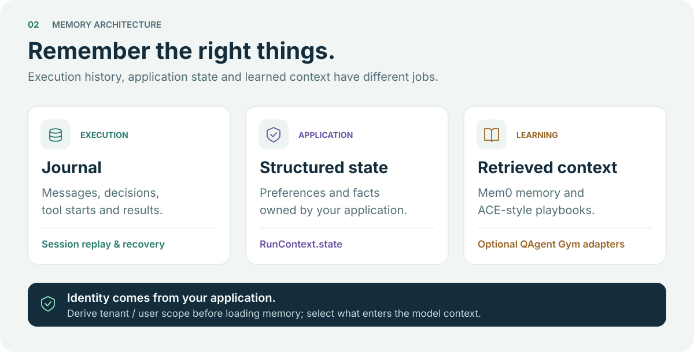

# Capabilities

Unmarked features are in the 0.2.0 release. *(unreleased)* marks work on `main` that is not
in a release yet. *(Effects 0.3 preview)* marks the unreleased [Effects](effects-preview.md)
work. *(experimental)* marks an API that is likely to change.

## Agent loop and limits

| Feature | API | Docs |
|---|---|---|
| Model requests and tool calls alternate until a final answer. Each model response is journaled before any tool it requested starts. | `Agent`, `run`, `stream`, `run_sync`, `resume`, `copy`, `RunResult` | [The loop](concepts/loop.md) |
| A run ends `completed`, `paused`, `limit_reached`, `cancelled` or `blocked`. | `RunResult.status` | [What a run returns](concepts/loop.md#what-a-run-returns) |
| Hard limits: turns (30 by default), tokens, cost and tool calls, counted across resumes. Wall-clock time per `run` or `resume` call and nesting depth (5 by default). A cost limit fails closed on an unpriced response. | `Limits(max_turns, max_total_tokens, max_cost_usd, timeout_s, max_tool_calls, max_depth)` | [Limits](concepts/loop.md#limits) |
| Per-tool timeouts, a parallel-tool policy, a result size cap and retries. By default the retry loop does not re-send a model request that may have been billed (`retry_ambiguous=False`). The in-flight request of a worker that died is sent again on recovery. | `Limits(tool_timeout_s, parallel_tools, max_tool_result_chars, model_retries, retry_ambiguous)` | [Retries and billing](concepts/loop.md#retries-and-billing) |
| A cancel or timeout reaches the provider request, compaction and running tools. The model is told per call whether it never started, was cancelled or has an unknown outcome. | `RunStream.cancel(reason)`, `RunHandle.cancel`, `Limits.timeout_s` | [Cancel](concepts/streaming.md#cancel) |

## Tools

A tool is a Python function with a docstring and type hints. Its signature becomes the tool
schema. A `RunContext` parameter supplies application dependencies and a stable operation id;
these are not arguments chosen by the model. [Built-in toolkits](toolkits.md) cover files,
shell commands, web access, notes, planning, clocks, human input and MCP servers.

## Tool API

| Feature | API | Docs |
|---|---|---|
| Typed tools. Pydantic validates the arguments before permissions, hooks or the function run. Sync tools run on a qagents-owned thread pool. | `@tool`, `Tool`, `Toolkit`, `ToolError`, `ToolTimeout` | [Tools](concepts/tools.md) |
| Tool flags | `read_only`, `idempotent`, `requires_approval`, `timeout`, `strict`, `deferred` | [Flags](concepts/tools.md#flags) |
| A context the model does not see: typed dependencies, an `operation_id` that stays the same when a call is repeated after a resume, session state, custom events and extra usage. | `RunContext[Deps]`, `deps`, `operation_id`, `state`, `emit`, `add_usage` | [The run context](concepts/tools.md#the-run-context) |
| Deferred tools pause the run. The result arrives later, from any process that can open the session. | `@tool(deferred=True)`, `DeferToolCall`, `PendingInput`, `agent.resume(results=...)` | [Deferred job example](https://github.com/qagents-ai/qagents/blob/main/examples/patterns/deferred_job.py) |
| A tool call journals a fact before it acts and reads it on a later attempt. Code outside the model can make a validated, permission-checked, journaled tool call of the run. *(unreleased)* | `RunContext.checkpoint`, `checkpoints`, `call_tool` | [The journal and crash recovery](concepts/external-agents.md#the-journal-and-crash-recovery) |
| A per-call memo revived on a rerun, and declared effects performed from a tool body. *(Effects 0.3 preview)* | `RunContext.memo`, `RunContext.perform`, `@tool(effects=[...])` | [Effects](effects-preview.md) |

## Permissions and approvals

| Feature | API | Docs |
|---|---|---|
| Rules in code, in a fixed order: deny, `can_use_tool`, ask, allow, mode, then the tool's `requires_approval` flag. A check that raises refuses the call. | `Permissions(allow, ask, deny, mode, can_use_tool, on_ask)`, `Decision` | [The decision order](concepts/permissions.md#the-decision-order) |
| An unanswered approval pauses the run. Resume in any process: deny rules and edited arguments are checked again, and a call that has a result never runs again. | `requires_approval=True`, `PendingApproval`, `agent.resume(approvals=...)`, `Approval(arguments=...)` | [Pause and resume](concepts/permissions.md#pause-and-resume) |
| Signed pauses: an HMAC-SHA256 token bound to the session, the call's position and the pause kind. A missing or wrong token raises before anything runs. | `Permissions(approval_secret=...)`, `Approval.for_call`, `InputResult.for_call`, `ApprovalTokenError` | [Signed pauses](concepts/permissions.md#signed-pauses) |
| Integers outside the safe JSON range are refused before signing. *(unreleased)* | `Permissions(approval_secret=...)` | [Signed pauses](concepts/permissions.md#signed-pauses) |
| Versioned decision records for effect tools, a conflicting second answer refused, and recorded hook changes to approved arguments. *(Effects 0.3 preview)* | `ApprovalConflictError`, `Hooks.may_change_approved_arguments` | [Effects](effects-preview.md) |

With the default `Permissions`, a tool runs without asking unless it sets
`requires_approval=True` or matches an `ask` rule, even if it writes. For approvals exchanged
outside the process, configure an `approval_secret` and preserve the pending token with
`Approval.for_call`.
Effects tools that ask for approval need the secret too when an effect declares a `Dedupe` or
`Unique` contract or an authoritative lookup: without it, such an effect whose outcome is unknown
is never re-sent automatically and, unless a lookup finds it, waits for an operator (the agent
warns when it is built, or at run start for a toolkit's tools).
Opaque and reconcilable effects are never re-sent automatically, with or without the secret.
Read the [approval guide](concepts/permissions.md) before exposing a remote approval
endpoint.

## Sessions and recovery

| Feature | API | Docs |
|---|---|---|
| An append-only, plain-JSON journal of messages, tool starts and results, decisions and run boundaries. Run state is derived from it. Nothing is pickled. | `Session`, `SessionStore`, `Entry` | [The journal](concepts/sessions.md#the-journal) |
| One JSON dict of session state for tools, hooks and instructions, restored on every run and resume. | `RunContext.state`, `state=` | [Scoped memory example](https://github.com/qagents-ai/qagents/blob/main/examples/scoped_memory.py) |
| Built-in stores with session status, listing and fenced leases. SQLite uses WAL and `synchronous=FULL`. | `InMemoryStore`, `SQLiteStore(path)` | [Stores](concepts/sessions.md#stores) |
| The same journal in PostgreSQL, with database-clock leases for workers on several hosts. Runs with declared effects are refused on it. | `qagents.stores.PostgresStore`, extra `postgres` | [Stores](concepts/sessions.md#stores) |
| Background runs under store leases with heartbeats. `recover()` takes over dead or failed runs. It skips a run whose last failure was ambiguous unless that run allows `retry_ambiguous`. | `AgentRuntime`, `start`, `submit`, `resume`, `recover`, `RunHandle` | [Serving](serving.md) |
| Lease and journal hardening: final state committed with tool outcomes, a run interrupted when lease renewal is refused, a fresh owner token for each acquisition. *(unreleased)* | `Agent.run`, `AgentRuntime` | [Sessions and recovery](concepts/sessions.md) |
| A lease lost while `start` or `resume` prepares a run raises `LeaseError` instead of a stray `CancelledError`. One lost while `recover()` prepares a run makes it pass that session over with a logged warning, so `run_forever` keeps polling. A cancel from outside still propagates. *(unreleased)* | `AgentRuntime.start`, `resume`, `recover`, `LeaseError` | [Serving](serving.md) |
| Store features for effects: stable entry ids, lease epochs, a store clock, an effect registry and cross-session claims, written through one fenced writer per session. *(Effects 0.3 preview)* | `SessionStore.features`, `acquire_lease_grant`, `LeasedWriter`, `Session.effects` | [Effects](effects-preview.md) |
| Operator entry points on the runtime. *(Effects 0.3 preview)* | `AgentRuntime.settle`, `AgentRuntime.recheck` | [Recover an external action](guides/recover-effect.md) |

A recorded tool result is replayed on recovery. An interrupted call that is neither read-only
nor idempotent is not repeated. The model is told its outcome is unknown. Delivery is
at-least-once, not exactly-once. Pass `ctx.operation_id` to a destination that enforces
idempotency, and set `idempotent=True` only when the destination makes retries safe. A
checkpoint alone cannot prove whether an external write happened. See
[what is guaranteed](concepts/sessions.md#what-is-guaranteed) and
[design boundaries](design.md).

## Durable workflows

| Feature | API | Docs |
|---|---|---|
| Plain-Python workflows. A finished step is replayed, never re-run, for the same workflow id. An agent step resumes at the exact tool call. An unfinished plain step runs again from its start. | `Workflow(store, id=...)`, `step`, `run_agent`, `completed_steps` | [Workflows](concepts/multi-agent.md#workflows) |
| One durable step per item, with bounded concurrency. | `Workflow.map(name, items, fn, concurrency=...)` | [Map-reduce example](https://github.com/qagents-ai/qagents/blob/main/examples/patterns/map_reduce.py) |
| External signals and durable timers suspend the workflow until it is resumed. A status view lists steps and agent runs. | `send_signal`, `wait_for_signal`, `wait_for_timer`, `status`, `WorkflowSuspended` | [Content flow example](https://github.com/qagents-ai/qagents/blob/main/examples/patterns/content_flow.py) |
| Recovery bound to the recorded run, separate journal and step identities, and the first recorded step result kept. *(unreleased)* | `Workflow.run_agent`, `Workflow.step` | [Workflows](concepts/multi-agent.md#workflows) |

## Several agents

| Feature | API | Docs |
|---|---|---|
| An agent used as a tool starts a linked child run. The child sees only its task and shares the parent's remaining token, cost and time budget. | `tools=[other_agent]`, `Agent.as_tool`, `agent.run(parent=ctx)`, `MaxDepthExceeded` | [Sub-agents](concepts/multi-agent.md#sub-agents) |
| Handoffs, including meshes. The target agent takes over the conversation. The calling agent's limits and permissions stay in force. | `Agent(handoffs=[...])`, `AgentSwitched`, `RunResult.agent` | [Handoffs](concepts/multi-agent.md#handoffs) |
| One child run per task, in parallel, as one tool. | `fan_out(agent, max_parallel=..., timeout=...)` | [Hierarchical crew example](https://github.com/qagents-ai/qagents/blob/main/examples/patterns/hierarchical_crew.py) |
| A classifier agent picks a specialist and runs it. | `route(classifier, routes, prompt, default=...)`, `RouteResult` | [Fallback router example](https://github.com/qagents-ai/qagents/blob/main/examples/patterns/fallback_router.py) |
| Team messaging: bounded FIFO inboxes, and `send_message` and `receive_messages` tools whose sender the host binds. *(unreleased, experimental)* | `TeamMailbox`, `TeamEndpoint`, `TeamMessage` | [Send messages between teammates](concepts/multi-agent.md#send-messages-between-teammates) |
| A mailbox in a local SQLite file. Unread messages survive restarts, processes on one host share it, and a resumed session replays recorded mailbox results. *(unreleased, experimental)* | `TeamMailbox(..., db_path=...)` | [Share a mailbox between processes](concepts/multi-agent.md#share-a-mailbox-between-processes) |

## Structured output and guardrails

| Feature | API | Docs |
|---|---|---|
| A typed final answer, requested as a native response format, in the instructions, or as a final-answer tool. Invalid answers are retried, then raise. | `Agent(output_type=..., output_mode="native" \| "prompted" \| "tool")`, `OutputValidationError` | [Structured output](concepts/structured-output.md) |
| Validators keep, replace or reject an accepted answer. A rejection sends the model a correction. | `Agent(output_validators=[...])`, `ModelRetry` | [Stock analysis example](https://github.com/qagents-ai/qagents/blob/main/examples/patterns/stock_analysis.py) |
| Input and output guardrails. A trip ends the run with status `blocked`, and it is journaled and emitted as an event. Output guardrails see the answer after its text has streamed. Hold it with `AGUIProjector(hold_final_answer=True)` or use `agent.run`. | `Agent(input_guardrails=..., output_guardrails=...)`, `GuardrailTripped`, `RunResult.guardrail` | [Content flow example](https://github.com/qagents-ai/qagents/blob/main/examples/patterns/content_flow.py) |

## Streaming, hooks and context

| Feature | API | Docs |
|---|---|---|
| An async iterator of typed Pydantic events, with token-level text deltas, then the final result. | `agent.stream()`, `RunStream`, `qagents.events` | [Streaming](concepts/streaming.md) |
| AG-UI events and server-sent events for CopilotKit and other AG-UI clients, with interrupts for approvals and deferred calls. Error text is withheld unless `expose_errors=True`. | `qagents.integrations.agui`: `to_agui_events`, `agui_sse`, `AGUIProjector`, `agui_resume` | [AG-UI module](https://github.com/qagents-ai/qagents/blob/main/src/qagents/integrations/agui.py) |
| A FastAPI example serving an agent over server-sent events, with approvals and questions to the user. It is sample code, not a packaged server. | `examples/serve_fastapi.py` | [Serving over HTTP](serving.md) |
| Hooks at fixed points of the loop. A hook that raises stops the run. `propagate=True` carries a hook into child runs. | `Hooks`: `on_run_start`, `before_model`, `after_model`, `before_tool`, `after_tool`, `on_event`, `on_run_end` | [Hooks](concepts/hooks.md#hooks) |
| Compaction clears old tool results or summarizes history before a request. A cut-off or empty summary raises instead of replacing the history. | `SummarizingCompactor`, `ToolResultClearing`, `CompactorChain` | [Long conversations](concepts/hooks.md#long-conversations) |
| Every string qagents itself sends to a model is a documented, replaceable constant. | `qagents.prompts` | [Prompts](reference/prompts.md) |

## Tracing, testing and evals

| Feature | API | Docs |
|---|---|---|
| OpenTelemetry spans for runs, model requests and tool calls, with child runs nested under the calling tool. Content and error text stay out unless `record_content=True`. | `qagents.tracing.OTelHooks`, extra `otel` | [Tracing](concepts/hooks.md#tracing) |
| One MLflow trace per top-level run, with AGENT, CHAT_MODEL and TOOL spans. | `qagents.integrations.mlflow.MLflowHooks`, extra `mlflow` | [MLflow example](https://github.com/qagents-ai/qagents/blob/main/examples/patterns/mlflow_tracing.py) |
| Test models that answer from a script or a function and keep every request for assertions. | `ScriptedModel`, `FunctionModel`, `call` | [Testing agents](testing.md) |
| Record model responses once, with secret-looking settings redacted (best effort. Read a cassette before committing it), and replay them offline. Replay mode makes CI refuse paid requests. | `cassette(model, path)`, `QAGENTS_CASSETTE_MODE=replay`, `CassetteMissError` | [Record and replay](https://github.com/qagents-ai/qagents/blob/main/examples/README.md#run-one-example) |
| Datasets, deterministic evaluators and an LLM judge. Reports compare runs for regressions and can be logged to MLflow. | `qagents.evals`: `Dataset`, `evaluate`, `LLMJudge`, `compare`, `regressions` | [Evals example](https://github.com/qagents-ai/qagents/blob/main/examples/patterns/evals_compare.py) |
| Crash exploration with fault injection and worker kills, and a store conformance check. *(Effects 0.3 preview)* | `qagents.testing.crash.crash_test`, `Faults`, `qagents.testing.stores.check_store` | [Crash harness](effects-preview.md) |

## Toolkits and MCP

Ready-made tools for files, shell, web, notes, plans and questions to the user, and both
sides of MCP (the server side is unreleased).

<details>
<summary>All toolkit and MCP features</summary>

| Feature | API | Docs |
|---|---|---|
| List, read and regex-search a workspace. Write and edit after approval. Links and junctions out of the folder are refused. | `qagents.toolkits.file_tools` | [Files](toolkits.md#files) |
| Workspace commands after approval. They get the full process environment. | `shell_tool` | [Shell](toolkits.md#shell) |
| Fetch public pages. The host name is resolved and checked for the first URL and every redirect, and non-public addresses are refused. The HTTP client resolves the name again when it connects, so DNS rebinding remains possible. Asks for approval unless `allow_hosts` is given. | `web_tools(allow_hosts=...)` | [Web](toolkits.md#web) |
| Markdown notes in a workspace folder as file-based memory. Saving and deleting need no approval outside the `qagents` command. | `notes_tools` | [Notes](toolkits.md#notes-memory) |
| A plan in session state, shown on every turn, including after compaction. | `todo_tools`, `render_todos`, `TodoItem` | [Long-running research example](https://github.com/qagents-ai/qagents/blob/main/examples/patterns/long_running_research.py) |
| A deferred tool that asks the person a question, and a read-only clock. | `ask_user`, `current_time` | [Human-in-the-loop example](https://github.com/qagents-ai/qagents/blob/main/examples/patterns/human_in_the_loop.py) |
| The tools of an MCP server over stdio or Streamable HTTP. Asks before any tool not declared read-only. Supports hash-pinned definitions. | `qagents.toolkits.mcp.MCPToolkit`, extra `mcp` | [Connect external tools](toolkits.md#connect-external-tools) |
| Timeouts, connection loss and unreadable responses during an MCP call raise `MCPAmbiguousError`, so the outcome stays unknown. *(unreleased)* | `qagents.errors.MCPAmbiguousError` | [Errors](reference/errors.md) |
| Serve qagents tools over MCP: bound to a run (127.0.0.1, bearer token, the run's permissions and journal), or standalone over stdio. *(unreleased)* | `qagents.integrations.mcp_server.tool_server`, `serve_stdio` | [Serving tools over MCP](integrations/mcp-server.md) |

</details>

## Model adapters

Native adapters, wrappers for failover and rate limits, and your own provider.

<details>
<summary>All model features</summary>

| Feature | API | Docs |
|---|---|---|
| QCloud through the official `qcloud_ai` SDK, with catalog capabilities and prices (so `max_cost_usd` works) and typed SDK errors. The SDK is installed from source. | `QCloudModel`, `"qcloud:<model-id>"`, `qagents models qcloud` | [QCloud](providers.md#qcloud) |
| Chat Completions for OpenAI and OpenAI-compatible servers, with streaming, tool-call deltas, retries and no redirects. | `OpenAIChatModel(model, base_url=..., api_key=...)` | [OpenAI-compatible servers](providers.md#openai-compatible-servers) |
| Claude through the official Messages API SDK: streaming, thinking replay, prompt caching and structured output. SDK retries are off by default (`max_retries=0`), and the loop does not retry a request that may have been billed unless `retry_ambiguous=True`. | `AnthropicModel`, `"anthropic:<model-id>"`, extra `anthropic` | [Model providers](providers.md) |
| Failover only on admission refusals, unless `allow_ambiguous=True`. Concurrency, request and token rates within a bounded wait. | `FallbackModel`, `RateLimitedModel` | [Fallback router example](https://github.com/qagents-ai/qagents/blob/main/examples/patterns/fallback_router.py) |
| Any provider behind one `stream` method, and a `"prefix:model-id"` string for it. | `Model`, `register_provider`, `resolve_model` | [Custom provider example](https://github.com/qagents-ai/qagents/blob/main/examples/custom_provider.py) |

</details>

## External agents *(unreleased)*

Drive another agent program that runs its own loop, such as a coding agent, and decide its
permission requests in your code. qagents itself cannot be served as an ACP agent, and ACP
usage is not metered.

<details>
<summary>All external-agent features</summary>

| Feature | API | Docs |
|---|---|---|
| An external agent as a tool (a linked child run), a workflow step or directly. Every permission request is decided by your `Permissions` and never answered "allow always". | `qagents.external.ExternalAgent`, `as_tool`, `stream`, `run`, `ScriptedExternalAgent` | [External agents](concepts/external-agents.md) |
| A generic ACP v1 client over stdio. ACP usage is not read, so ACP agents are unmetered. | `qagents.integrations.acp.ACPAgent` | [Any ACP agent](integrations/acp.md) |
| Devvi as a coding worker over ACP (the default. No token counts) or its SDK protocol (token usage, and cost with `pricing=`), with telemetry off and qagents tools exposed to Devvi over MCP. Devvi sends permission requests only for escalations. Reads, edits, plain commands in the workspace and web fetches run without one. | `qagents.integrations.devvi.DevviAgent`, `python -m qagents.integrations.devvi doctor` | [Devvi](integrations/devvi.md) |
| Span events for an external agent's permission decisions and finished turns. | `OTelHooks` | [Events](concepts/external-agents.md#events) |

</details>

## Docs, command line and packaging

<details>
<summary>All docs, command-line and packaging features</summary>

| Feature | API | Docs |
|---|---|---|
| Chat or run one prompt with streaming, inline approvals, tool sets, SQLite sessions and cost limits. List the QCloud catalog. | `qagents chat`, `qagents run`, `qagents models qcloud`. `qagents docs` *(unreleased)* | [Command-line module](https://github.com/qagents-ai/qagents/blob/main/src/qagents/cli.py) |
| A docs MCP server and command line that answer from the installed version's docs, examples and API, with a checker for invented names and unawaited coroutines. *(unreleased)* | `python -m qagents.docs_mcp`: `search_docs`, `get_api`, `check_code` | [Docs for coding agents](coding-agents.md) |
| Generated `llms.txt` and `llms-full.txt`, checked in CI. *(unreleased)* | `scripts/build_llms_txt.py --check` | [llms.txt](coding-agents.md#llmstxt) |
| Instructions and a Claude Code skill for coding agents. They do not cover Effects yet, and AGENTS.md's "Tools with side effects ask first" does not match the default `Permissions`. *(unreleased)* | [`AGENTS.md`](https://github.com/qagents-ai/qagents/blob/main/AGENTS.md), [`skills/qagents/SKILL.md`](https://github.com/qagents-ai/qagents/blob/main/skills/qagents/SKILL.md) | [AGENTS.md](coding-agents.md#agentsmd) |
| The core depends only on Pydantic and HTTPX. Names from optional extras resolve on first access. | extras `anthropic`, `mcp`, `mlflow`, `postgres`, `otel`, `evals`, `acp`, `devvi`, `qcloud` | [pyproject.toml](https://github.com/qagents-ai/qagents/blob/main/pyproject.toml) |
| README diagrams from a small, versioned Python SVG renderer, with Mermaid sources alongside. *(unreleased)* | `scripts/draw_readme.py` | [Diagrams](diagrams/README.md) |

</details>

## Examples

<details>
<summary>All examples</summary>

| Example | Run | Docs |
|---|---|---|
| LangGraph- and CrewAI-style patterns, runnable on Anthropic, QCloud or an OpenAI-compatible server, each with an offline test. A run can be recorded once and replayed offline. No cassettes are committed yet. | `python -m examples.patterns.<name>` | [Examples](https://github.com/qagents-ai/qagents/blob/main/examples/README.md) |
| Support review assistant: propose a case, approve it, write it to a local SQLite queue. *(unreleased)* | `python examples/support_review.py` | [Support review guide](guides/support-review.md) |
| A keyless tour, a QCloud quickstart, a custom provider and a paid live QCloud acceptance script. | `python examples/offline_tour.py` | [Other examples](https://github.com/qagents-ai/qagents/blob/main/examples/README.md#other-examples-in-this-folder) |
| Scoped preference memory in session state. *(unreleased)* | `python -m examples.scoped_memory --database preferences.db` | [Scoped memory](integrations/gym.md#start-with-session-memory) |
| A coordinator, a researcher and a reviewer exchanging messages. *(unreleased)* | `python -m examples.team_messages` | [Send messages between teammates](concepts/multi-agent.md#send-messages-between-teammates) |
| A lost credit response recovered through an operator settlement, and a subprocess crash test of a simulated Stripe refund. The test suite does not run them. *(Effects 0.3 preview)* | `python -m examples.recover_credit --directory DIR`, `python -m examples.subprocess_refund` | [Recover an external action](guides/recover-effect.md) |

</details>

## Memory across long-running work

The journal records execution history. Structured session state holds application facts and
preferences. Retrieval tools bring relevant memories and playbook entries into later runs
through application or QAgent Gym adapters.



Run a complete offline memory example:

```bash
python -m examples.scoped_memory --database preferences.db
```

It approves a preference write, closes and reopens SQLite, and reads the preference with
a new agent. The same tenant/user sees `el`. A different tenant or user sees `unset`.
The application supplies identity. The model cannot choose another user's memory scope.
See [scoped memory](integrations/gym.md#start-with-session-memory) for the code and tests.
qagents has no built-in vector store or memory product. Retrieval is a tool you write.

## QAgent Gym: learn across episodes

[QAgent Gym](integrations/gym.md) adds ACE-style context learning, playbooks, scoped
memory and evaluations in a separate, private project (repository access is required). Mem0
retrieval, LangGraph and DSPy adapters,
ElevenLabs synthesis and Twilio telephony recipes connect to the application boundary.
Context updates and RL weight training are different workflows. The integration guide states
what each example actually exercises. qagents itself contains no Gym adapter code.
