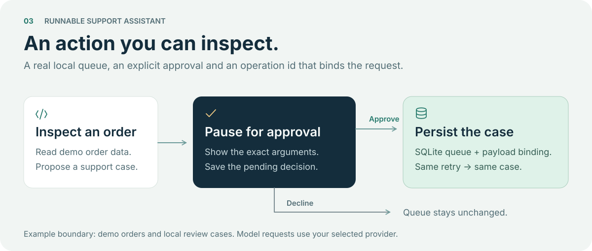

# Build an agent that queues support reviews

The support agent checks an order with a read-only tool, proposes a case,
and waits for a person to approve it. A separate SQLite queue stores each
case with the durable tool operation ID and its payload. Starting the
resume in another worker reopens the same journal. The example uses demo
orders and writes a local review case.



## Configure the model

Install the project from your private checkout. Use the Anthropic extra
when you select that provider.

```bash
python -m pip install -e .
python -m pip install -e ".[anthropic]"
```

Set credentials in your environment or secret manager. Select a model ID
available in your provider account.

| Provider | Model variable | Credential variable | CLI value |
| --- | --- | --- | --- |
| QCloud | `QCLOUD_MODEL` | `QCLOUD_API_KEY` | `qcloud` |
| OpenAI | `OPENAI_MODEL` | `OPENAI_API_KEY` | `openai` |
| Anthropic | `ANTHROPIC_MODEL` | `ANTHROPIC_API_KEY` | `anthropic` |

From the checkout, run the example and follow the approval prompt.

```bash
python examples/support_review.py --provider openai
```

The tests run the same tools with a scripted model and a real local SQLite
queue. They exercise pausing, restarting, approving and declining a write
without credentials.

```bash
python -m pytest tests/examples/test_support_review.py
```

## Inspect the source

```python
--8<-- "examples/support_review.py"
```

For persistent preferences, see [scoped session memory](../integrations/gym.md#start-with-session-memory).
