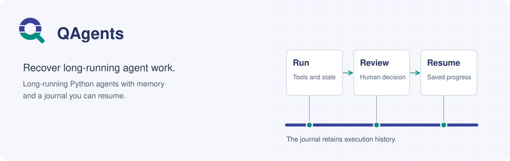
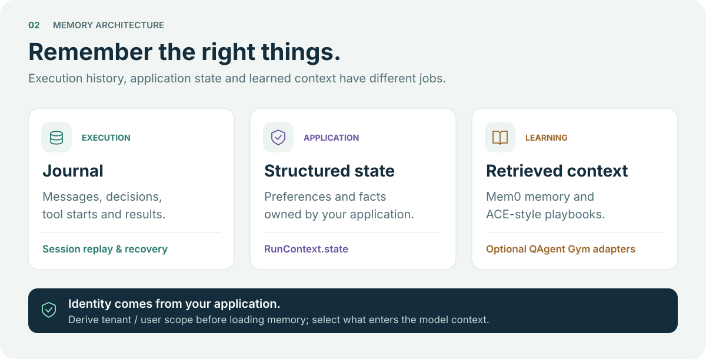

# QAgents

Build long-running Python agents that can call tools, wait for a human decision,
and resume on another worker. The session journal preserves messages, decisions,
and application state across restarts. Connect retrieval memory or a QAgent Gym
playbook when the agent needs knowledge from earlier sessions.



[Run the approval and recovery example](guides/support-review.md) ·
[Configure a model provider](providers.md) ·
[Connect memory and QAgent Gym](integrations/gym.md) ·
[Compare with other frameworks](comparison.md) |
[Browse application examples](https://github.com/qagents-ai/qagents-examples) |
[Read the capability reference](capabilities.md)

!!! note "Development status"
    The package version is 0.2.0 alpha. Features on `main` may be unreleased.
    Provider tests use controlled transports; live QCloud acceptance remains open.
    Check [verification evidence](design.md#what-is-verified) and the
    [Effects preview status](effects-preview.md) before planning a deployment.

## Find a guide

| You want | You write | Read more |
|---|---|---|
| An answer | `await agent.run("...")` or `agent.run_sync("...")` | [The loop](concepts/loop.md) |
| Tokens and tool activity as they happen | `async for event in agent.stream("...")` | [Streaming](concepts/streaming.md) |
| A tool | a typed Python function with `@tool` | [Tools](concepts/tools.md) |
| A typed answer | `Agent(..., output_type=Invoice)` | [Structured output](concepts/structured-output.md) |
| A conversation that survives restarts | `session=Session(SQLiteStore("agents.db"), id="user-42")` | [Sessions](concepts/sessions.md) |
| A human in the loop | `@tool(requires_approval=True)` and `agent.resume(...)` | [Permissions](concepts/permissions.md) |
| Hard stops | `Limits(max_turns=..., max_cost_usd=..., timeout_s=...)` | [The loop](concepts/loop.md#limits) |
| Your code inside the loop | subclass `Hooks` | [Hooks](concepts/hooks.md) |
| Several agents | `tools=[other_agent]` or `handoffs=[other_agent]` | [Several agents](concepts/multi-agent.md) |
| Another coding agent as a worker | `tools=[DevviAgent(workspace=repo).as_tool(timeout=1800)]` | [External agents](concepts/external-agents.md), [Devvi](integrations/devvi.md) |
| Any ACP agent | `ACPAgent(["node", ".../bin.js", "--acp"], workspace=...)` | [Any ACP agent](integrations/acp.md) |
| Your tools inside a coding agent | `tool_server(tools, ctx=ctx)`, `expose_tools=[...]` | [Serving tools over MCP](integrations/mcp-server.md) |
| A multi-step job that resumes | `Workflow(store, id=...)` | [Workflows](concepts/multi-agent.md#workflows) |
| An external write recovered after a lost response (Effects 0.3 preview, unreleased) | `@effect(...)` and `ctx.perform(...)` | [Recover an external action](guides/recover-effect.md) |
| Traces | `hooks=[OTelHooks()]` | [Tracing](concepts/hooks.md#tracing) |
| Tests without a model | `ScriptedModel([...])` | [Testing](testing.md) |
| Learning loops, memory and adapter recipes | the separate QAgent Gym package | [Gym and integrations](integrations/gym.md) |
| Docs your coding agent can query | `python -m qagents.docs_mcp` (MCP) or `qagents docs search "..."` | [Docs for coding agents](coding-agents.md) |

## Long-running work

An agent that finishes in one request has few state transitions to coordinate.
An agent that works across several requests must recover its progress when a
worker stops, keep a pending decision tied to the right tool call, and report
an uncertain external outcome accurately. The session journal records the
conversation and the decisions that drive execution. Run limits, permissions
and tool declarations give application code control at each boundary.



Use session memory for one workflow or conversation. Use a scoped retrieval
store such as Mem0 for information that should carry into another run. Gym can
turn feedback from completed episodes into playbook updates for later runs.
Choose identity, access and retention rules in the application.

QCloud, OpenAI Chat and Anthropic have built-in adapters. The provider guide
shows the configuration and model choices that were verified.

## Layout

```text
agent.py        the Agent, the loop, RunStream
messages.py     provider-neutral messages
tools.py        @tool, Tool, Toolkit, RunContext
permissions.py  allow / ask / deny rules and approvals
hooks.py        hook points around the run, the model request and each tool call
session.py      the journal: Session, InMemoryStore, SQLiteStore
workflow.py     durable steps for multi-step and multi-agent jobs
multi.py        fan_out and route
runtime.py      AgentRuntime: background runs with leases and recovery
context.py      compaction of long conversations
tracing.py      OpenTelemetry spans
evals.py        datasets, evaluators and reports
prompts.py      every string the framework itself sends to a model
models/         QCloudModel, OpenAIChatModel, AnthropicModel, FallbackModel, test models
stores/         PostgresStore
toolkits/       file, shell, web, notes, clock, planning, ask_user and MCP tools
external/       external agents: other agent programs driven over a control protocol
integrations/   the ACP client, Devvi, the MCP tool server, AG-UI events, MLflow tracing
docs_mcp/       the docs MCP server and command line for coding agents
cli.py          the qagents command: chat, run, models, docs
```
